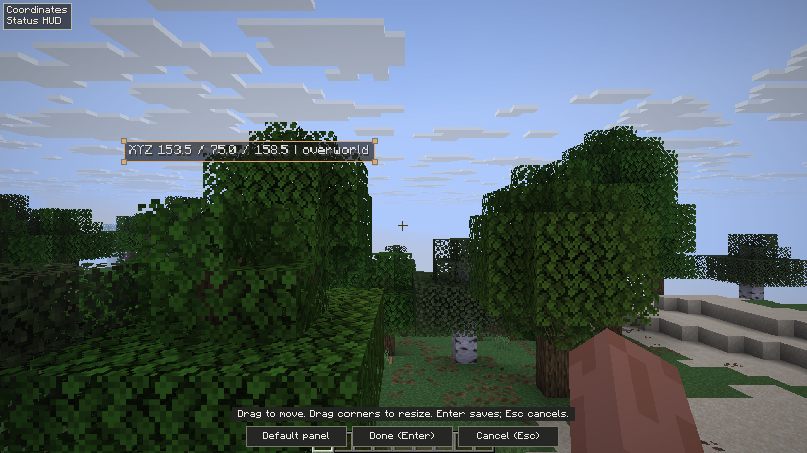
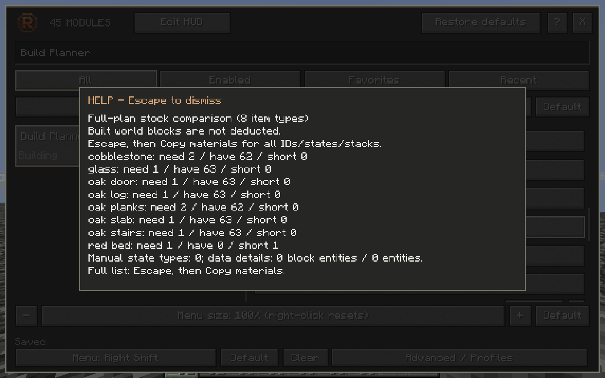
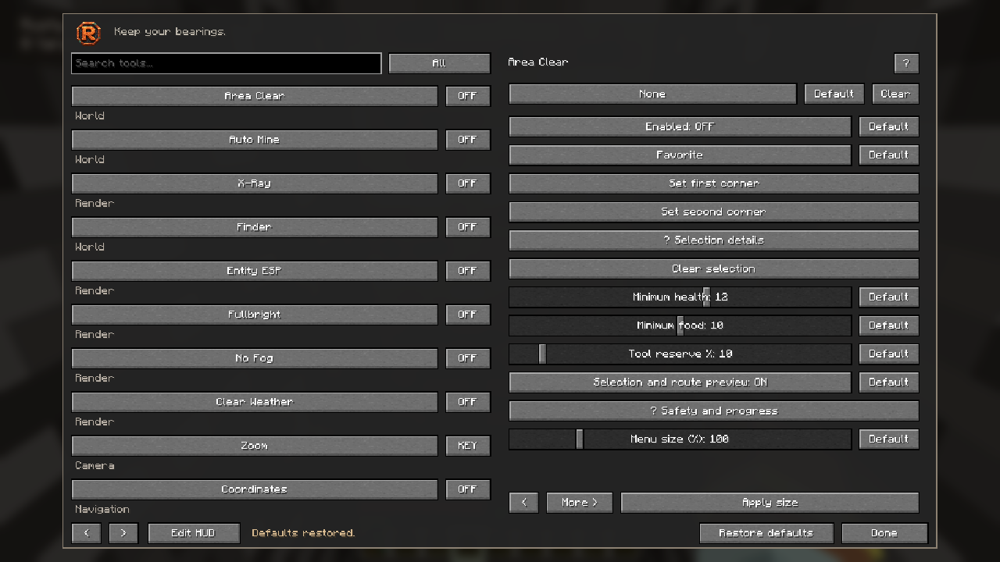
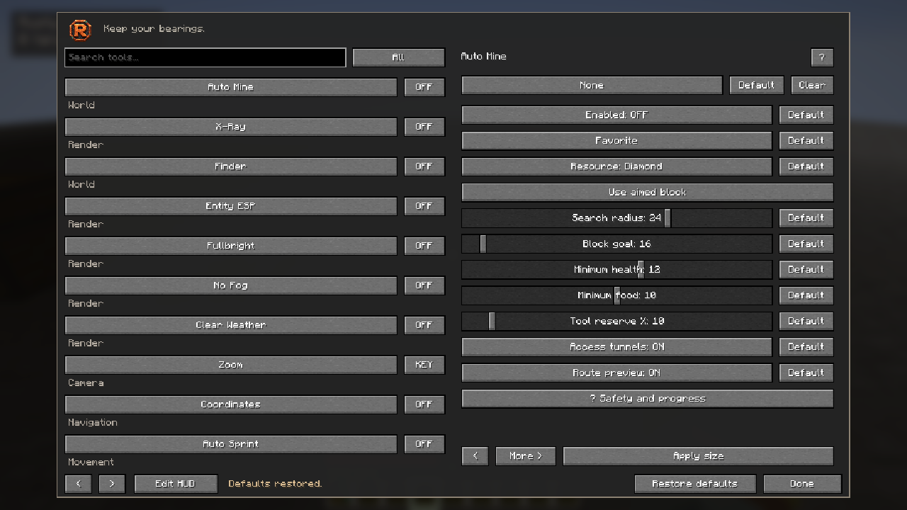

<p align="center"></p>
<p align="center"><strong>Keep your bearings.</strong></p>
<p align="center">45 configurable tools · Horizon · Fabric · NeoForge · Minecraft 26.3</p>

<p align="center"><a href="https://github.com/Justeck/Rusty/actions/workflows/build.yml"></a> <a href="https://github.com/Justeck/Rusty/actions/workflows/java.yml"></a>  <a href="LICENSE"></a></p>

**Rusty is a native Rust toolkit for Horizon, with Fabric and NeoForge counterparts:** a familiar Minecraft interface, textured world views, independent HUD layouts, local navigation and ordinary player assistance. Press **Right Shift** to open the menu. Search by module, setting or description, then enable the tools you want.

**New in 1.4: Schematic Builder.** Choose a local schematic with the native file picker, review the transformed preview and copy its materials list. Start explicitly to walk, select inventory materials and place supported blocks through ordinary game actions. Select two corners in an opened world to export a states-only `.schem`. [Schematic guide and limits](docs/SCHEMATICS.md).

**Auto Mine remains available.** Select a resource and block goal, then explicitly start a bounded route that weighs walking and mining time. Normal player controls perform each action, with live terrain checks, server acknowledgment, supported drop collection and immediate manual takeover. Off and unbound by default. [Auto Mine guide](docs/AUTO_MINE.md) · [Validation and limits](docs/VALIDATION.md).

Arrange your HUD directly in the game view: click **Edit HUD**, drag overlays into place and resize with corner handles. **Enter** saves; **Escape** cancels. Independent Entity Tracers target choices remain available.

<p align="center"></p>

<p align="center"><a href="https://github.com/Justeck/Rusty/releases/latest">Download</a> · <a href="docs/INSTALLATION.md">Installation</a> · <a href="docs/MODULES.md">Modules</a> · <a href="docs/screenshots/README.md">Screenshots</a> · <a href="docs/VALIDATION.md">Validation</a></p>

## Editions

| Edition | Game/runtime | Installation |
|---|---|---|
| **Horizon native 1.4.0** | Horizon 66f3981 · API 411 · Minecraft 26.3 · Rust | Native GitHub input below |
| **Fabric 1.4.0-beta.1** | Minecraft 26.3 · Java 25 · Fabric Loader 0.20.1+ and Fabric API | [Java guide](java/README.md) |
| **NeoForge 1.4.0-beta.1** | Minecraft 26.3 · Java 25 · NeoForge 26.3.0.101 | [Java guide](java/README.md) |

The Java counterparts share Minecraft-style controls and a 45-module catalog, with edition-specific behavior and validation. Their restricted multiplayer tools require authoritative server opt-in; ordinary information tools work on unmodified servers. [Permissions and differences](java/README.md#multiplayer-permissions) · [Java validation](docs/JAVA_VALIDATION.md). The stable native release remains the GitHub `latest` so Horizon's installer keeps resolving its native package.

An earlier Fabric and NeoForge beta was [submitted to Modrinth](https://modrinth.com/mod/rusty-toolkit) with explicit AI code, asset and text disclosures. Approval and public availability remain unconfirmed; GitHub remains the available download source. [Submission record](docs/evidence/modrinth-submission.json) · [Area Clear acceptance](docs/evidence/area-clear-1.3.1.json) · [Published downloads and launcher installation](docs/evidence/area-clear-publication-1.3.1.json).

## Install

In Horizon Launcher, select **Horizon → Mods → Add a Native Mod from GitHub** and enter:

```text
https://github.com/Justeck/Rusty
```

Review the selected immutable source revision and enable Rusty. If Horizon offers **Build**, choose **Performance** and wait for **Up to date** before **Play**. An identical native mod set can reuse its verified build. The supported base is Horizon **66f3981**, native API **411**, Minecraft Java **26.3**. Every enabled native mod must support the selected host.

The fixed release input is [`https://github.com/Justeck/Rusty/releases/tag/v1.4.0`](https://github.com/Justeck/Rusty/releases/tag/v1.4.0). The [Schematic Builder](docs/SCHEMATICS.md), [Area Clear](docs/AREA_CLEAR.md) and [Auto Mine](docs/AUTO_MINE.md) guides describe their controls and conservative limits. Historical receipts retain their original release scope. [Validation](docs/VALIDATION.md) distinguishes automated checks, actual game tests and launcher installation.

**Auto Mine** is an explicitly started resource mode with ore presets, aimed Custom blocks, weighted routes, ordinary walking and mining, a block goal and conservative safety stops. It uses received terrain and waits for normal server acknowledgments. It stays off by default and never resumes a stopped run. [Controls, defaults and limitations](docs/AUTO_MINE.md).

**X-Ray changes terrain only.** Block-target boxes, block tracer lines and Finder readouts require **Finder** to be enabled separately. X-ray toggles preserve Finder and line preferences.

**Menu size now defaults to 100% at the former 70% physical size.** Scale from 50% to 300%, or reset to 100%. Existing saved physical sizes are preserved; HUD scaling remains independent.

**Entity Tracers** has its own **Players**, **Mobs** and **Dropped Items** switches, independent of Entity ESP. Select any combination or none, with individual Default controls and saved profile choices. For example, show mob boxes while tracing dropped items. Finder still controls block tracers separately.

**Enabled Mods** adds a vertical, alphabetically ordered list of active Rusty tools in the top-left. It is opt-in and has its own draggable position and corner handles in **Edit HUD**.

**Default** buttons restore individual preferences or shortcuts. **Restore defaults** in the menu header restores all Rusty settings after confirmation, including shortcuts, appearance and HUD layout. Active tools stop; saved waypoint and named profile files are kept.

**Right Shift** opens Rusty. **Options → Mods → Rusty** remains the recovery path. See [Installation](docs/INSTALLATION.md), [Usage](docs/USAGE.md) and [Modules](docs/MODULES.md).

## Familiar controls, less friction

### A file, a materials list, a plan you control

**Build Planner → Load schematic** opens the operating system file picker for modern `.schem`, `.litematic` and structure `.nbt` files. Import does not start building. Place the origin, rotate or mirror the plan and inspect exact states. The materials list includes item quantities, stacks, available inventory and missing amounts, with a **Copy materials** button.

Construction uses bounded normal walking, main-inventory sourcing and received placement verification. It reports occupied, unsupported or inaccessible work instead of demolishing obstructions or adding scaffolding. Export captures settled received states between two inclusive corners, without container contents or entities. [Step-by-step workflow](docs/SCHEMATICS.md).



Original, unretouched Horizon capture from the owned survival-construction test. Quantities describe the full plan; already-built world blocks are not deducted. [Screenshot provenance](docs/evidence/schematic-media-1.4.0.json).

### Choose a box. Clear it under your control.

Aim at two opposite corners in **Area Clear**, review the inclusive dimensions and start explicitly. The green box and route preview show the planned work. Independent safety defaults and strict deliberate excavation boundaries keep the operation bounded. Containers, fluids and unsafe or unreachable leftovers are protected and reported. Manual controls or opening a menu stop it; it never resumes automatically. [Area Clear controls and limitations](docs/AREA_CLEAR.md).



Original, unretouched capture from the owned Fabric 26.3 acceptance world. The Horizon edition offers the same controls through its native Minecraft-style menu; multiplayer permission requirements differ by edition.

### Resource routes, under your control

Choose a resource, radius and block goal in **Auto Mine**, then explicitly start the mode. It weighs normal walking and mining time, uses suitable hotbar tools, checks live terrain before each action and can approach supported openings to collect drops. Manual controls, menus, damage and unsafe or failed actions stop it. The mode starts off and unbound and never resumes itself. Its conservative, bounded planner cannot reveal server-hidden ores or guarantee invulnerability. [Full controls and defaults](docs/AUTO_MINE.md).



Original Fabric beta.7 capture from the owned acceptance world; the Horizon edition exposes the same mining settings through its native Minecraft-style menu. Multiplayer permission requirements differ by edition as documented above.

- Minecraft-style buttons and clear name/category spacing across Classic, Graphite and Copper.
- Live **Enabled**, Favorites and Recent collections; instant search and contextual **?** help.
- Rebind or **Clear** a shortcut, including the menu shortcut. Native settings remain available for recovery.
- Individual **Default** controls and a confirmed **Restore defaults** for the whole mod.
- Independent menu size, with sliders, step controls and reset.
- Position, size and reset controls for **19 HUD overlays**, saved locally. Default columns fit expanded contents and leave room for the minimap.
- Original block-texture frames in X-ray: **25% by default**, thin textured edges at minimum, ordinary terrain at maximum. **X** toggles by default; optional Hold mode deactivates on release.

<p align="center"></p>

A **ten-second still-image tour** of the real native interface and renderer. [MP4](docs/media/rusty-1.2-ui-tour.mp4) · [Original captures and provenance](docs/screenshots/README.md). This is presentation media, not continuous gameplay or a frame-rate recording.

## See Rusty in use

**Original game captures**, with separate Horizon and Java galleries. The new Java tour contains 39 scenes: texture coverage from minimum to 100%, ore/custom-block filters, Finder, outlines, navigation, Freecam, lighting restoration, HUD placement and the full menu workflow. Each image has a caption and an original-file hash.

| Textured view — Java edition | Compact Minecraft-style controls — Java edition |
|---|---|
| [](docs/screenshots/java/tour/README.md#terrain-and-block-selection) | [](docs/screenshots/java/tour/README.md#interface-and-settings) |

| Detached camera — Java edition | Independent HUD layout — Java edition |
|---|---|
| [](docs/screenshots/java/tour/README.md#world-tools) | [](docs/screenshots/java/tour/README.md#interface-and-settings) |

[**Browse the full screenshot collection →**](docs/screenshots/README.md) · [**39-scene Java tour →**](docs/screenshots/java/tour/README.md) · [**Modrinth gallery →**](https://modrinth.com/mod/rusty-toolkit/gallery)

The Java tour uses an authored, disposable singleplayer fixture. Restricted Java tools need explicit server opt-in in multiplayer. A screenshot illustrates an interface or view; it is not a new functional-test claim. Modrinth remains under review, and its gallery excludes generated artwork.

## Choose your tools

| Area | Modules |
|---|---|
| World views | X-Ray, Finder, Entity ESP, Entity Tracers, Storage ESP, Chunk Borders, Light Risk, Trajectories, Target Info, Minimap |
| Visibility and camera | Fullbright, No Fog, Clear Weather, Zoom, No Hurt Camera, Freecam |
| Assistance and building | Area Clear, Auto Mine, Auto Sprint, Safe Walk, Auto Jump, Auto Tool, Trigger Bot, Auto Eat, Auto Fish, Auto Totem, Armor Assist, Auto Refill, Build Planner |
| Navigation | Compass, Waypoints, Breadcrumbs, Death Markers, Waypoint Walk, Portal Coordinates |
| Information | Coordinates, Status HUD, Enabled Mods, Equipment HUD, Environment HUD, Container Preview, Speed HUD, World Clock, Frame Rate, Click Counter |

The catalog contains **45 actual modules**. **Status HUD** starts enabled; other modules start off. Zoom works while its shortcut is held. Gameplay automation and inventory actions are opt-in. [Modules](docs/MODULES.md) explains each tool's bounded behavior.

Rusty uses data the client receives. Servers may withhold or replace block information, and retain authority over movement, reach, inventory and health. Finite work budgets, unknown chunks and unsupported data remain explicit limits. Freecam leaves the player body in ordinary simulation.

## Build and verify

```sh
cargo test --locked --features native-tools
cargo run --locked --features native-tools --bin rusty-native -- package
```

Runtime and optional native packaging tools are Rust. Python is development-only game-test orchestration. [Development](docs/DEVELOPMENT.md) covers exact pins, SDK checks and real game fixtures.

[Architecture](docs/ARCHITECTURE.md) · [Validation](docs/VALIDATION.md) · [Performance](docs/PERFORMANCE.md) · [Research](docs/research/README.md) · [Changelog](CHANGELOG.md) · [Contributing](CONTRIBUTING.md) · [Security](SECURITY.md)

## License and attribution

Rusty is **Apache-2.0**, with applicable **MIT** component notices. The native X-ray foundation includes work by **1_st_Cat / RealCat1st**; the camera includes MIT code by **umbx-dot**; Horizon is by **Ludovic Marie and contributors**. Preserve [LICENSE](LICENSE), [NOTICE](NOTICE), [THIRD-PARTY.md](THIRD-PARTY.md), [LEGAL.md](LEGAL.md) and component notices.

The integrated copper [R badge]USTY wordmark are original project branding, distinct from the official Rust mark. The graphite/copper artwork set includes a transparent emblem, wordmark and repository cover; see the [brand guide](docs/assets/BRAND.md). [Artwork provenance](docs/assets/branding.json) records the generated originals. Game resources, accounts and player worlds are not distributed.
