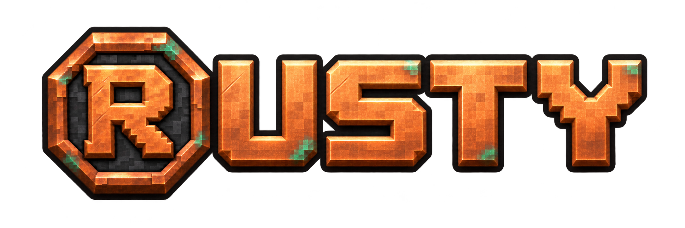

# Rusty 1.2.2

Native compatibility update for **Horizon Nightly 38609b7 / API 409 / Minecraft 26.3**.

Horizon replaced its held-key set with a device-aware input container. The previous Freecam integration used collection methods that container no longer supports, preventing the native client from compiling. Rusty now removes the relevant movement mappings individually while detached and restores only movement keys physically held when Freecam exits. Unrelated held mappings retain their device ownership.

The 42-tool catalog, Minecraft-style interface, integrated copper R identity, textured terrain context and configurable controls remain available. The renderer test helper recognizes the exact new SDK without modifying upstream source.

Install in Horizon Launcher with `https://github.com/Justeck/Rusty` or the fixed release input `https://github.com/Justeck/Rusty/releases/tag/v1.2.2`. Enable Rusty, select **Performance build**, then use **Rebuild on Horizon Nightly 2026-11-05** (or **Build** if already on that base). Wait for **Up to date**, then **Play**. Right Shift opens the menu; Options → Mods → Rusty remains available. Package: `rusty-1.2.2.hnmod` with `SHA256SUMS`.

Fresh build and game validation is recorded in [Validation](https://github.com/Justeck/Rusty/blob/main/docs/VALIDATION.md), separately from earlier exhaustive acceptance. The Fabric and NeoForge beta is a separate Java edition and has not been changed by this native patch.

Server anti-X-ray may withhold or replace information. Servers retain authority over movement, inventory, reach and health. No arbitrary-server compatibility or superiority over other clients is claimed.

Apache-2.0 with applicable MIT notices. Preserve LICENSE, NOTICE, THIRD-PARTY.md and component notices. No game resources, accounts or player worlds are distributed.
