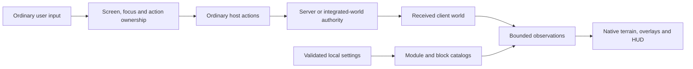

# Native architecture

Rusty 1.2 is a Rust source mod compiled into the pinned Horizon client. The [native manifest](../horizon-native.json), [compatibility record](../compatibility.json) and [mixin manifest](../mixins/rusty/horizon-mixin.toml) identify the exact host and source transformations. Java reference clients supply research ideas; their loaders, runtimes and assets are absent from the native package.

## Modules and interface

[catalog.rs](../mixins/rusty/catalog.rs) defines the 42 user-facing modules, their categories, aliases, descriptions, settings and default shortcuts. A catalog entry corresponds to an implemented adapter. Search, themes, favorites, recent tools and profiles support this catalog and are not additional modules.

[clickgui_model.rs](../mixins/rusty/clickgui_model.rs) holds testable search editing, navigation and save state. [clickgui.rs](../mixins/rusty/clickgui.rs) binds that model to Horizon's native non-pausing Mod screen. The screen draws over the continuing world, owns its input and releases it on closure. Native settings remain available as a fallback. The shared text-shortcut predicate prevents a shortcut's separate character callback from inserting its letter into search; ordinary Unicode callbacks and Control+Alt text remain eligible. Actual OS composition/layout coverage is recorded separately in [Validation](VALIDATION.md).

The root [Rust library](../lib.rs) imports the same pure source files used by the native bundle. This keeps configuration, search, rule matching, navigation and action-state tests tied to production logic. Game adapters remain small consumers of that logic and the pinned host APIs.

[hud_layout.rs](../mixins/rusty/hud_layout.rs) validates and resolves independent normalized placements for 18 screen overlays. Defaults form three content-aware columns, with the right column reserving room above the default minimap. [hud_render.rs](../mixins/rusty/hud_render.rs) records bounded vertex ranges and applies the resolved transforms once after drawing the panels. The shared bridge depends on the renderer rather than gameplay, avoiding a crate dependency cycle. Explicit custom placements remain independent; world-space geometry never enters this screen-layout path.

## Multiplayer terrain and rendering

The original native X-ray explicitly rejected a world without an integrated server or a published local world, and its frame callback forced X-ray off in those cases. Removing those checks alone would leave the old rendering and lifecycle assumptions in place.

Rusty filters the worker's freshly filled meshing scratch through [filter.rs](../mixins/rusty/filter.rs) and [runtime.rs](../mixins/rusty/runtime.rs). The authoritative received chunk sections remain intact. The compiled block catalog applies enabled block IDs, state properties and inclusive height bounds. Native X-ray terrain spans received chunks within the game's rendering range. Finder and per-rule radii separately bound scanned results, boxes and tracer overlays.

[visuals.rs](../mixins/rusty/visuals.rs) validates cached section identities and neighboring sections, processes a bounded rebuild queue, and invalidates derived results when configuration, position, received data or world scope changes. Stationary frames can reuse distance/filter/sort results after that validation. Chunk unloading removes observations that no longer have received source data. Connection and dimension transitions reset transient state.

[terrain.rs](../mixins/rusty/terrain.rs) builds nearby context faces from the installed block models, texture atlas and tint information. The texture control retains frames around open face centers; its maximum selects the ordinary terrain and lighting path. No resource-pack textures are bundled. Finite section, target and context-face budgets bound work. The partial-result flag can therefore describe a terrain-context limit even when the target-count limit has not been reached.

## Actions and local state

Movement, inventory, fishing and building adapters use ordinary host actions and received observations. Screen/focus ownership, manual input, held items, pending transactions and world scope constrain eligibility. Predicted inventory state is kept distinct from server acknowledgment. In particular, a fresh ordinary Use or Attack edge can authorize one further conservative refill demand; held input, elapsed time and a queued prediction do not become blanket permission to repeat actions. [Modules](MODULES.md) documents the practical boundaries and late-correction ambiguity.

Build Planner retains its bounded cuboid preview and one-action placement. Its separate schematic model uses bounded named-state NBT decoding, incremental registry validation and transformed previews. File dialogs and bounded file work run off the game thread. Explicit schematic construction surveys received states, searches safe walking access, sources inventory through normal swaps and checks predicted placement effects before dispatch. A correlated ordinary own-player statistics response can confirm processing of an otherwise silent successful swap; exact source/destination identities and contradictory corrections still gate use. Final completion requires fresh settled exact states. [Schematic workflow and limits](SCHEMATICS.md). Waypoint Walk uses the host's loaded-terrain pathfinder for a temporary user-started route. Freecam moves a detached view while the body continues normal simulation. These mechanisms leave health, inventory, reach and movement outcomes under the world's authority.

Feature profiles and navigation use bounded local files. Marker identity includes the verified world/server and dimension. Breadcrumbs are bounded session observations and are cleared rather than persisted as an action script. Disabled features avoid their expensive observations; caches and transient actions are cleared or suspended at the documented lifecycle boundaries.

## Build and evidence boundaries

[Development](DEVELOPMENT.md) describes the supported transformer, Performance build, package checker and isolated runtime fixtures. The `.hnmod` contains native source, manifests and required notices. Horizon resolves a GitHub installation to an immutable release asset or source commit and compiles the enabled native mod set.

Source CI, a package checksum, a built executable, observed gameplay and a Launcher-produced installation have separate identities. [Validation](VALIDATION.md) links those identities to actual results; [Performance](PERFORMANCE.md) separates the measured host, workload, warm-up and baseline limitations. Tests for one executable are not silently reassigned to another build.

[Module guide](MODULES.md) · [Research](research/README.md) · [Installation](INSTALLATION.md)
