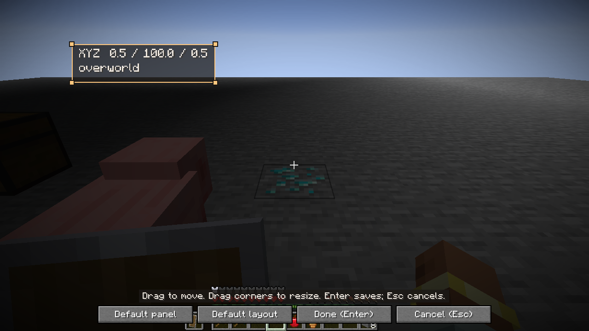
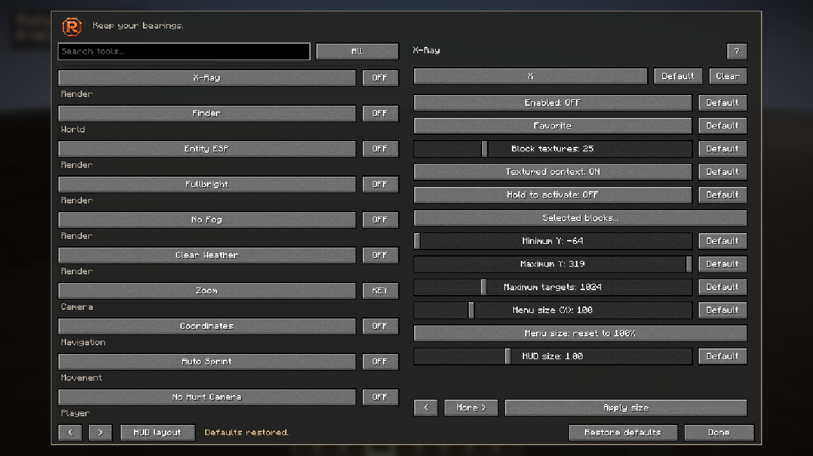
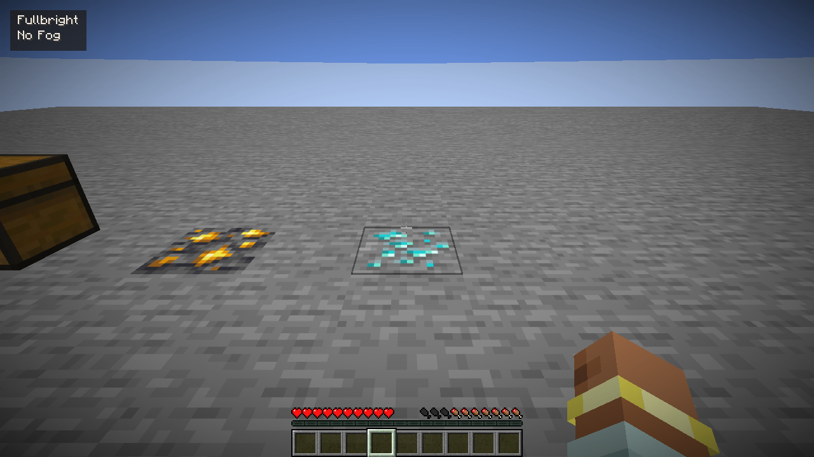

# 1.3.0-beta.5 independent tracer targets

## Beta.6 published package verification

The [GitHub Java release](https://github.com/Justeck/Rusty/releases/tag/java-v1.3.0-beta.6) and both saved Modrinth beta.6 versions were downloaded and checked. All runtime archive entries equal the actual game-tested builds; Modrinth downloads are byte-identical to GitHub. Source archive Java files differ only in CRLF/LF line endings, and `SHA256SUMS` records public asset bytes. Modrinth’s guide and reviewed HUD screenshot were verified after reloading the public page. Its project remains under review. [Publication receipt](evidence/hud-publication-1.2.7.json).

## Java 1.3.0-beta.6 — visual HUD editor

Both supported loader builds and QA compilation passed, with **1,231 shared core assertions** and **83 actual owned-world checks per loader**. The new checks select enabled-only HUD panels, drag real screen bounds without changing the saved configuration, resize with corner handles, confirm with Minecraft’s Enter key, cancel with Escape and return to the same menu. Existing target, texture, permission, action, default/reset, active-list, chunk and dimension checks also ran.

The editor keeps a draft of positions and sizes; feature states are unchanged. Its world background remains clear without changing the player’s video options. Core tests cover all corner anchors, viewport-edge constraints and movement clamping. A read-only review also caught the physical menu-key polling path; it is suppressed while the editor is active. Physical-device input is not claimed by the automated fixture.

Original frames were visually inspected. An initial test used obsolete GLFW Enter/Escape values; Minecraft26.3 uses InputConstants, and the corrected full fixtures passed. These are supported development-client game runs, not fresh public-server or personal-launcher published-jar acceptance. Public archive equivalence is checked separately. [Exact receipt](evidence/hud-editor-1.2.7.json).

Both loader builds, source packages, **1,215 shared core assertions** and **76 actual disposable-world game checks per loader** passed. Tests cover independent received pig/item lines and ESP boxes, empty selections, independent disable/default actions, actual tracer menu widgets, and the existing X-ray/Finder, chunk/dimension, menu/HUD and inventory regressions.

The renderer gives entity tracers an independent **128-line budget**, alongside the existing **768 main geometry entries**. A saturation regression failed with the former shared pool, then passed with stable endpoint identities under ESP and Finder saturation. This is a core-buffer contract; the game fixture uses controlled pig/item targets. Old Java profiles inherit missing tracer flags from their former shared ESP choices once; explicit new false values survive reload/import.

[Exact acceptance and media provenance](evidence/tracer-targets-1.2.6.json). The gameplay illustration shows the original beta.5 feature candidate; final core and game acceptance separately cover the reviewed capacity fix. Release-jar product-class equivalence is checked after publication. No fresh public-server, second-player, arbitrary-modpack, alternate-renderer, endurance or published-jar personal-launcher acceptance is claimed. Restricted tools still require authoritative server opt-in.

# Java edition validation — 1.3.0-beta.4

**Enabled Mods** is a separate, opt-in Interface feature: active Rusty tools appear alphabetically in top-left rows, excluding the list itself. The nineteenth HUD panel has independent placement/size. Minecraft-style Default controls restore individual values and shortcuts; the menu-wide Restore defaults asks for confirmation, resets all preferences and runtime tools, and retains saved waypoint/profile files.

Fresh supported-toolchain builds, package inspection and QA compilation passed, with **692 shared behavioral assertions** and **65 actual disposable-world game checks per loader**. Both Fabric and NeoForge exercised real widget callbacks for numeric, true-boolean and shortcut defaults; confirmation and Cancel; full reset with active X-ray/Freecam; saved waypoint/profile preservation; and actual active-list bounds, update and removal. Original gameplay/menu frames were inspected. The existing scanner, texture, X-ray/Finder, inventory-action, chunk/dimension lifecycle, HUD-layout and menu-scale checks also ran.

The [exact receipt](evidence/defaults-list-1.2.5.json) records identities and named checks. Game checks use owned singleplayer fixtures through the supported development clients. They are not a fresh public-server, arbitrary-modpack, endurance, alternate-renderer or published-jar personal-launcher acceptance. Restricted multiplayer tools still require authoritative server opt-in. Historical results below retain their own version and scope.

# 1.3.0-beta.3 compact-menu acceptance (historical)

The former 70% menu size is now the **100% default**, with a **50–300%** slider and a **100% reset**. Saved physical sizes stay unchanged. Both keyboard adjustments and slider release apply the fitted scale; the existing Apply size button is retained. HUD controls remain independent.

Fresh builds, package inspection and QA compilation passed. **621 shared behavioral assertions** cover the new baseline, bounds, legacy-size preservation and viewport fitting in addition to the existing suite. **Fabric and NeoForge each passed 53 actual game checks** through their supported development toolchains in disposable offline worlds. New checks inspect the actual screen transform and widget bounds at 50%, 100% and 300%, then restore the default before the existing X-ray/Finder and gameplay regressions. [Exact patch evidence](evidence/menu-scale-1.2.4.json).

No fresh remote-server, published-jar personal-launcher, endurance or arbitrary-modpack test is claimed. Earlier receipts below retain their own version and scope. Restricted multiplayer tools continue to require explicit server opt-in.

# 1.3.0-beta.2 acceptance (historical)

X-ray terrain rendering and Finder target geometry are now independent. Line/box controls live under Finder, and X-ray toggles preserve Finder and saved preferences.

Fresh builds on Minecraft **26.3 / Java 25**, **609 shared behavioral assertions**, package inspection and QA-source compilation passed. Both **Fabric and NeoForge completed 49 actual in-game checks** through their supported development toolchains in disposable offline worlds. Four added rendered-geometry assertions verify X-ray alone with saved lines/boxes enabled, explicit Finder opt-in, Finder continuing with X-ray off, and X-ray alone again after independent toggles. The [patch receipt](evidence/xray-independence-1.2.3.json) includes the exact named checks and local package hashes.

No fresh remote-server or published-jar launcher test is claimed for beta.2. Earlier dedicated-server, performance and input results below retain their original version/scope. The first regression attempt stopped at accessibility onboarding; only the isolated QA options were corrected before rerunning. Restricted multiplayer features continue to require server opt-in.

# 1.3.0-beta.1 acceptance (historical)

Horizon native 1.2.0 has its own [accepted report](VALIDATION.md). This report applies to the separate Minecraft 26.3 Fabric/NeoForge counterparts. No personal world, public-server character, account inventory or launcher installation was used as a Java test fixture.

## Toolchain and artifacts

- Minecraft 26.3, Java 25 (Temurin 25.0.5+8), Gradle 9.8.2 with distribution checksum.
- Fabric Loader 0.20.1, Fabric API 0.165.2+26.3, Loom 1.19.3.
- NeoForge 26.3.0.101, ModDevGradle 2.0.148.
- Both loader runtime/source jars build. `java/verify_artifacts.py` checks version/manifests, source completeness, notices, and absence of QA/Minecraft/loader classes in installable packages. See [checksums](../java/SHA256SUMS).
- Shared core: **609 behavioral assertions**, run as both a JUnit acceptance entry and a plain Java executable. These cover permission lifecycle, hold/toggle/focus/quick taps, full-width readout fitting, config limits, cache ownership, actual settings-file replacement and nonoverlapping HUD packing.
- The QA mod is a separate development source set. It is excluded from runtime and source jars. Its guarded fixture refuses personal game paths/worlds and non-loopback remote addresses.

## Actual game checks

Both loaders launched through their supported development toolchains and joined an exact, copied disposable `RustyLab` world. Each completed **44 in-game checks**, including:

- Real Minecraft widgets and recovery access with a cleared menu binding; actual local settings/profile files; independent 18-panel HUD bounds, default full-width packing, editor footer clearance and hotbar clearance.
- Original-texture quad generation, exposed and buried received ores, removal/restoration, custom target selection, target caps/partial state, minimum/maximum context and off/on restoration.
- Detached camera movement and rendering while preserving body position/rotation; chunk unload/reload, dimension transitions and reattachment in the new dimension.
- A harvest-correct tool replacing a faster ineligible golden pickaxe; manual hotbar ownership; ordinary eating and slot restoration; empty-offhand totem transfer, shield preservation, empty-slot armor, exact-stack refill and an ordinary reachable living-target attack.
- A synthetic authoritative inventory correction remains stopped for 25 ticks; explicit off/on rearm then retries the retained observed refill candidate. This exercises correction-state handling; it is not a measurement of every possible server rejection sequence.
- All registered adapters enabled in a received world for smoke/crash coverage, with bounded overlay output and a 30-second final rendering observation. A batch smoke check is not per-module functional proof.

**Physical input:** short X taps were observed to activate and restore textured terrain in both loader clients. The polling-only prototype missed a brief tap; the released implementation retains press events with parity and clears them at world/connection boundaries. Hold/release/focus behavior is covered by shared-controller checks; long-held physical-key automation is not claimed. Windows automation did not establish a modifier-only Right Shift press; menu default 229 is the official SDL Right Shift scancode, with Options recovery independently checked.

## Dedicated server checks

Separate official Minecraft 26.3 server processes bound to loopback were used; these are actual TCP client/server tests, not an integrated-world substitute.

| Server/client | Observed result |
|---|---|
| Unmodified vanilla server → Fabric client | Joins without Rusty on the server; restricted requested tools stay inactive; ordinary information overlays render. |
| Unmodified vanilla server → NeoForge client | Same behavior. |
| Optional Fabric server component → Fabric client | Authoritative `view` grant enables real received target scanning; `combat` stays denied; live revocation disables the view. |
| Optional NeoForge server component → NeoForge client | Same behavior. |

Each permissioned-client run also rejects malformed payload versions, masks and lengths and accepts the valid two-byte payload. The receiver captures its actual listener; stale listeners cannot relabel a grant as belonging to a replacement connection. Permissions are not stored in profiles. Reconnect resets are covered by core ownership checks and source review; no claim of every public-server/proxy topology is made.

An early permissioned-server run failed because a grant could arrive before client ownership initialization, or the server could mark an unavailable channel as delivered. The client now retains only a current-listener grant until initialization; the server retries until the channel actually accepts delivery. Both matching loader/server pairs passed after those corrections. Fabric's final receiver is per connection, registered before channel advertisement; NeoForge uses its payload context listener.

## Performance and review

Work is capped: received target index 4096 maximum; scanner 4096–32768 cells and 32 palette checks per tick; overlay snapshot 768 primitives; entity inspection 512; storage inspection 512 and 128 matches; minimap 32 of 576 cells per tick; A* 4096 nodes/128-block route; breadcrumbs 512 samples. Dense/unknown areas can be partial. Texture frames emit more geometry than ordinary full faces and may reduce frame rate.

The accepted raw receipts retain sampled Minecraft FPS, Java heap usage and counts during the fixture. This is a short observation on one Windows/Intel Iris Xe machine, not a cross-hardware benchmark, frame-time distribution, long endurance test or proof of no leaks. No superiority over other clients is claimed. Horizon's separate native ten-minute run does not establish Java endurance.

An independent whole-branch review identified and rechecked harvest eligibility, Freecam/minimap world state, explicit action rearming, refill-candidate ownership, storage inspection limits and minimum scan budget. Follow-up review covered actual receiver identity, successful channel delivery and queued-key lifecycle. Material findings were corrected before release.

## Explicit limits

- Only Minecraft 26.3 and the pinned loaders are validated. Earlier versions, snapshots, third-party rendering replacements/shaders, mixed-loader server transports and arbitrary public servers are unverified.
- Auto Fish's received-bite path, full pathfinding/build-placement scenarios, every movement edge and every individual cosmetic/overlay option have source/smoke coverage rather than exhaustive end-to-end action cases. Do not read 42 catalog entries as 42 individually certified features.
- Ordinary server corrections, reach, cooldowns, inventory and health remain authoritative. Restricted Java features require real server opt-in; the unmodified-server tests prove denial, not unrestricted X-ray there.
- Received surface minimap, approximate block-only trajectories, sampled light warnings and manual-cast reeling have the edition-specific limits in the [Java guide](../java/README.md).
- Remeshing completes through the game's normal asynchronous chunk rebuilds; a toggle changes effective state immediately but full terrain rebuilding need not finish in the same frame.
- Server anti-X-ray may replace or withhold block information. Rusty does not obtain it. No personal or public server was used to test bypasses.

## Evidence

Sanitized [game receipts](evidence/java) include actual check names, times, counts, short performance samples and SHA256 references to preserved raw receipts. They are readouts, not generated success summaries. Original local logs/source snapshots are retained privately; account/device paths are not published. [Original Java screenshots](screenshots/java) are captured with Minecraft's F2 function, without retouching. Build Actions provide independent compilation/package checks, not live graphics proof.

## Release-candidate identity

Final source uses full-width fitting and an editor footer reserve. NeoForge11 and Fabric16 each passed 44 game checks on that implementation; separate Fabric14/NeoForge09 TCP tests cover the unchanged permission transport. Build10 verified all four packages. The installable runtime files match their compiled loader/core output and exclude the QA harness. Exact final SHA256 values are in the linked checksums.

Additional manual controls are recorded in [the UI receipt](evidence/java/manual-controls.json). GitHub branch checks independently compile the same source; the public release is produced by the checked workflow. NeoForge version bounds apply on both client and server; a fresh dedicated-server boot with the final metadata also reached ready. The installed [native package and sole Horizon instance](evidence/java/native-installation-preserved.json) remain unchanged.

## Branding patch follow-up

The integrated [R badge]USTY wordmark and standalone menu badge use original generated artwork, with provenance in the brand guide. Fresh Fabric and NeoForge game runs after the menu-header change each passed 45 checks, including the framebuffer capture. The final menu image is captured directly from Minecraft’s framebuffer by the separate QA mod; this capture does not alter runtime jars.

Modrinth refused the generated logo upload. At the user’s explicit request, the two Java beta versions were subsequently submitted for manual moderation without generated project-page artwork. The description and formal disclosure explicitly identify predominantly AI-produced code, generated in-game assets and AI-assisted text. The observed status is **Under review**, rather than approved/public; unauthenticated API lookups return 404. [Submission record](evidence/modrinth-submission.json). GitHub remains the available download source; no image-detection workaround or Modrinth approval is claimed.
