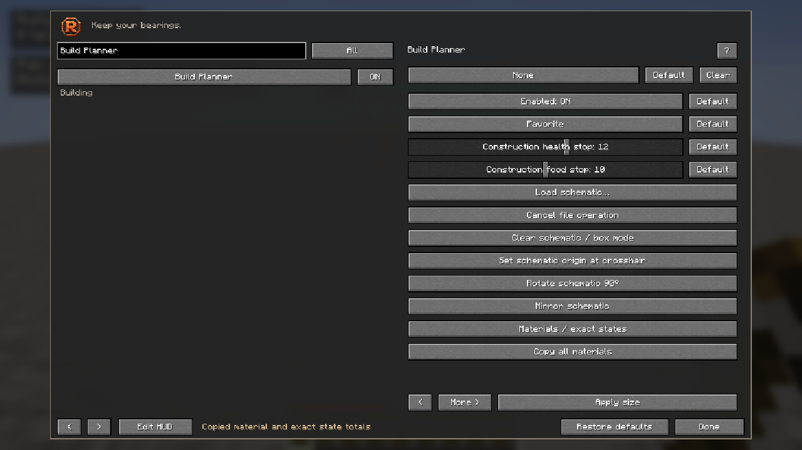
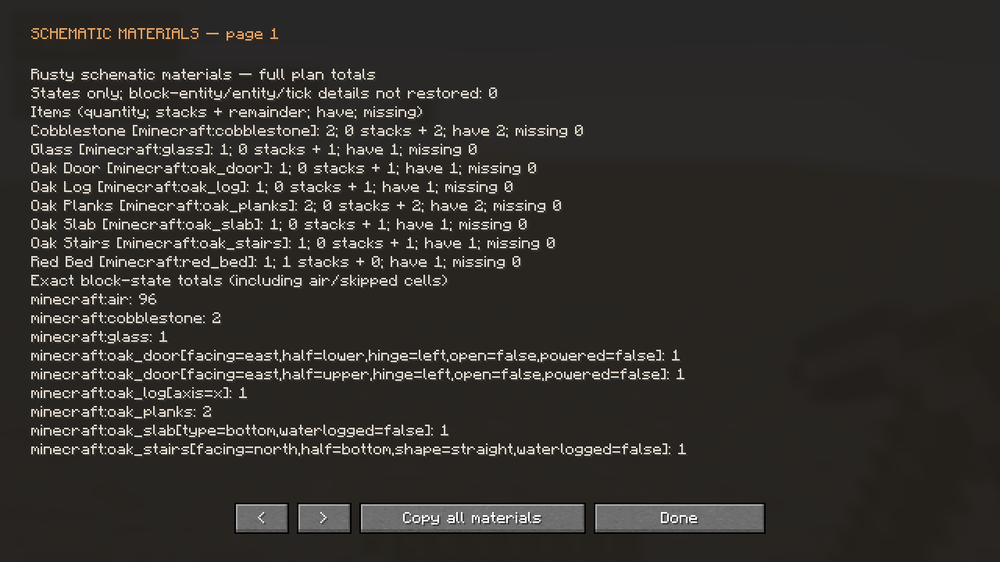

# Schematic Builder

Build Planner can load a local schematic, preview its exact block states, list the materials and construct supported parts using ordinary player movement, inventory actions and block placement. Loading a file never starts construction.

## Import and place a plan

1. Enable **Build Planner** for its preview, then choose **Load schematic** in its settings. Choose a file in the operating system's file picker. Cancel leaves the preceding accepted plan intact.
2. Let validation finish. Unknown blocks, properties and values reject the import, including unused entries in a declared palette. A file from another game version may need conversion in that version first.
3. Aim at the intended origin and select **Schematic origin** (Java: **Set schematic origin at crosshair**). Review the preview. **Rotate schematic** and **Mirror schematic** update both coordinates and supported directional properties.
4. Open **Materials** (Java: **Materials / exact states**). **Copy materials** (Java: **Copy all materials**) copies the list to the system clipboard. Check required items, available inventory and missing amounts before starting.
5. Supply the materials, stand on safe loaded terrain and choose **Start construction**. The menu closes so normal gameplay controls can operate. Construction remains explicit and opt-in.

The original box planner remains available through **Clear schematic**. Clearing a plan or changing its transform stops construction. Plans and active construction are transient; they do not restart after a connection or dimension change.

## Supported files and bounds

| File | Supported data |
|---|---|
| `.schem` | Modern Sponge schematic versions 2 and 3 |
| `.litematic` | Named-state versions 4–7, including signed region sizes |
| `.nbt` | Vanilla structure palettes and sparse block positions |

Imports accept bounded uncompressed or gzip-compressed NBT. Legacy numeric-ID `.schematic` files need external conversion; changing the filename does not convert them. Input is limited to 32 MiB, expanded NBT to 64 MiB, nesting to 64, each bounding axis to 256 blocks, the bounding volume to 1,048,576 cells and the palette to 65,536 states. Additional tag, allocation and coordinate checks apply.

Sparse gaps remain unspecified. Actual air cells do not authorize demolition: the builder places blocks and reports occupied conflicts instead of clearing them. Entities, container contents, sign text and other block-entity payloads are not reconstructed. These omissions are disclosed when importing relevant data.

## Materials and clipboard

The materials view separates obtainable items from exact block-state totals and unsupported/manual work. Item totals account for ordinary placement semantics: a double slab needs two slabs, layers need multiple items, and a complete door or bed uses one item for its two cells. An orphan secondary half cannot be built by itself. Stack counts use the item's registry stack limit.

Inventory availability describes the player's accessible inventory, not nearby containers. The list is a planning aid; construction rechecks the actual stack and received world state before every action. It does not create or replenish items. Copying does not send the list in chat.

Quantities describe the full imported plan. Blocks already present in the world are not deducted from this stock comparison. Native item rows show required, available and missing amounts separately; if the list exceeds the current menu size, the popup explains how to copy the complete item IDs, exact states and stack counts.

## What automatic construction does

Rusty searches a bounded local walking route on received terrain. It does not mine an access tunnel, fly, teleport or create scaffolding. When a needed material is in the main inventory, it performs an ordinary inventory swap into the hotbar, preserving the displaced stack. It waits for server processing and rejects contradictory inventory corrections before using that slot.

Placement uses normal reach and a real supported face. The desired orientation and all known affected cells must match the plan before dispatch. Doors and beds require their partner cells to be present and compatible. Slabs and supported layered blocks may need several normal uses. Existing matching blocks are retained. Occupied mismatches, protected or unknown terrain, unsupported states and inaccessible orientations remain explicit leftovers; they are not silently replaced or counted as complete.

Completion requires a fresh exact-state survey of every planned non-air block after received placement settlement. Air and unspecified gaps do not authorize clearing existing blocks. A stopped, rejected or failed transformation is not completion. The terminal summary separates initially matching cells, newly completed cells, final matches, occupied cells, missing cells, unsupported/inaccessible work and manual/data-detail leftovers. Missing includes the manual/inaccessible subsets. Its bounded final readback performs no actions and cannot resume construction. Some builds need manual access, support or placement order changes before an explicit restart.

Changes to relevant target blocks or chunk availability invalidate an unfinished survey. Rusty retries within a bounded work and time budget; a persistently changing or unavailable target remains unverified instead of being reported as complete. Initial and final counts remain explicitly uncertain until a coherent survey has finished.

## Stops and multiplayer

Manual gameplay input, opening a menu, loss of focus, damage, unsafe health or food, teleport/correction, world or dimension changes, missing material, denied inventory/placement, unexpected block changes and timeouts stop the operation. It never resumes automatically. Already-dispatched ordinary requests can still settle after stopping; Rusty does not undo server actions. **Construction minimum health** ranges from 1–20 health points (default **12**, or six ordinary hearts); **Construction minimum food** ranges from 0–20 (default **10**). Individual **Default** buttons and **Restore defaults** restore them. Changing a setting never restarts a stopped run. Any received local-player damage remains a separate stop, including damage absorbed without reducing health. The hard run limit is 30 minutes.

Construction requires Survival or Creative building permission at Start and throughout the run. Losing that permission stops construction before another action. The server remains authoritative over movement, inventory and placement. No server extension is required for the native Horizon edition's ordinary actions. Fabric and NeoForge retain Rusty's explicit current-server capability permissions; restricted construction needs the documented view, movement and assistance grants. Server rules and normal action limits still apply.

The bounded planner cannot guarantee a globally shortest route, invulnerability, arbitrary modded-block behavior or survival recreation of every possible saved block state. Fluids, technical states, special items and unproven reactive relationships can require manual work. Unknown chunks are never treated as empty space.

## Export a selection from a world

1. Open the source world normally. Use an owned world or an area you have permission to inspect.
2. Aim at one corner and select **Export first corner** (Java: **Export: set first corner**), then aim at the opposite corner and select **Export second corner** (Java: **Export: set second corner**). Both endpoints are inclusive.
3. Choose **Save selection** (Java: **Save states-only selection…**), select a destination and confirm replacement if the file already exists.

Rusty captures settled block states already available to the client, incrementally, and writes a modern Sponge `.schem` file. Unknown, unavailable or unsettled cells make export fail rather than inventing air. The exported origin is local to the selection. Entities, block-entity contents and text are not saved. This reads an opened world; it does not edit or parse an arbitrary unopened save folder.

Cancelling a file operation or changing worlds invalidates its result. A native picker already open may need to be closed before another picker can open. Files are written with bounded, failure-safe replacement; an unsupported filesystem operation reports an error. Cancel before atomic commit prevents the write. If commit has already begun, that explicitly chosen snapshot may finish saving; Rusty reports this boundary and keeps cancellation responsive. Cancelling never activates a stale import or starts construction.

The Horizon-native chooser uses Windows' Explorer dialog, the macOS system chooser, or the installed `zenity` helper on Linux. An unavailable desktop helper reports an error. Native compilation and actual-game acceptance here used Windows; other desktops have not received live dialog testing. Final physical Save/overwrite acceptance has its own delivery gate, separate from the parser, real-I/O tests and command-path export/import checks.

## Fabric and NeoForge controls

The shared Minecraft-style menu groups import, transform and materials controls on one page, with explicit construction and export on the next. **More >** switches pages. **Materials / exact states** opens a readable list; its **Copy all materials** button copies all pages. The native Horizon menu exposes the corresponding actions in the Build Planner's scrolling settings panel.

[Original screenshot gallery and provenance](screenshots/README.md) · [Modules](MODULES.md) · [Usage](USAGE.md) · [Validation](VALIDATION.md)
