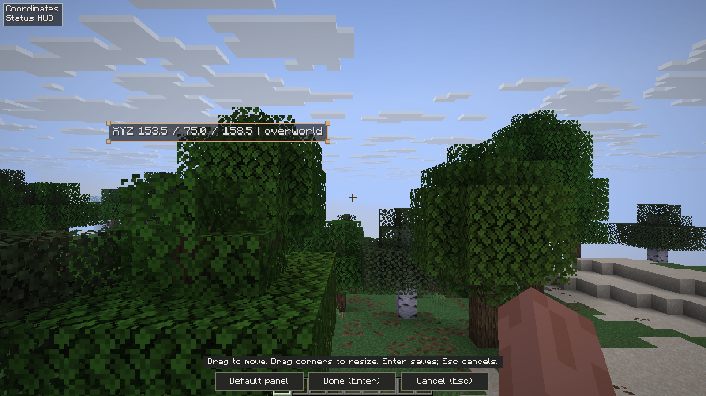
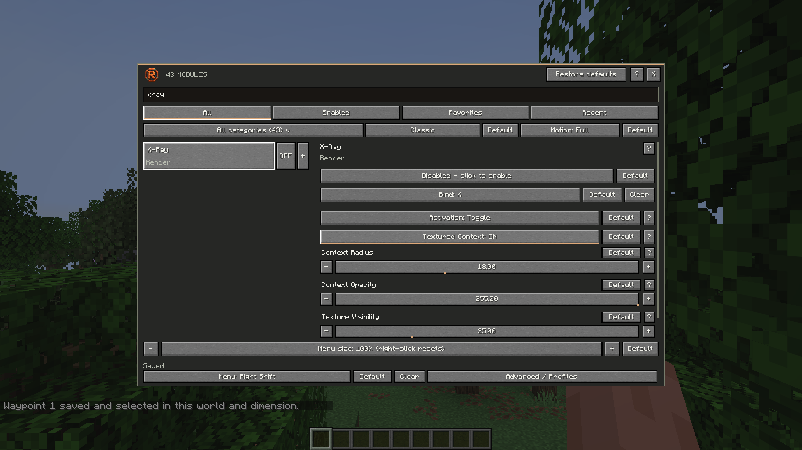
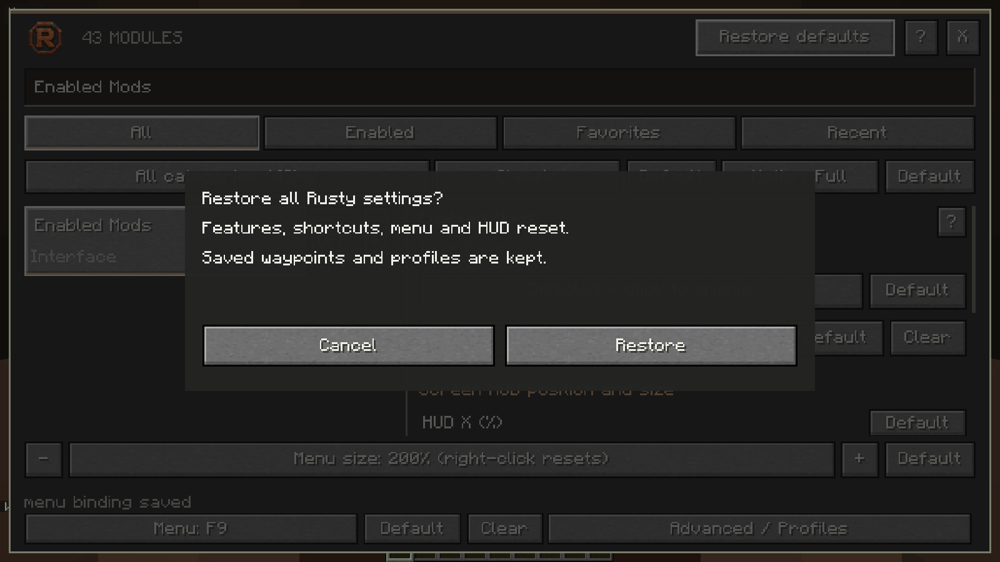
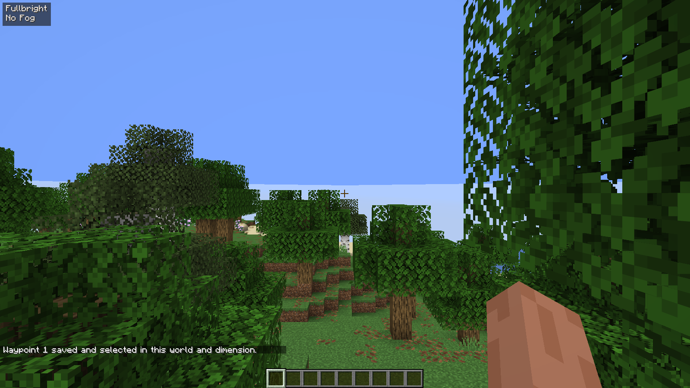
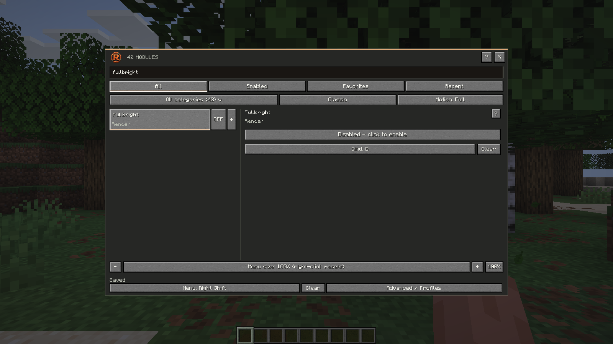

# Rusty validation

## 1.4.0 — Schematic Builder acceptance

The official launcher **0.2.47** compiled the native candidate in **Performance** mode for **Horizon 66f3981 / API411 / Minecraft26.3**, exited successfully and selected `native-66f3981-258e68b91497`. The command took 27.0 minutes including installation and cleanup. This is a completed official build; normal launcher GUI delivery is verified separately.

| Actual native suite | Passing checks |
|---|---:|
| Schematic construction and safety in an owned singleplayer world | 19 |
| Schematic construction and safety on a separate unmodified vanilla Java server | 17 |
| Existing Area Clear in singleplayer | 15 |
| Existing Auto Mine in singleplayer | 14 |
| Existing Area Clear on a separate vanilla server | 14 |

Both hotbar and full-hotbar/main-inventory construction produce **12 exact target cells with 10 ordinary placement items**. The separate server independently confirms all final states and preserved inventory, including 45 displaced sticks. Tests cover walking beyond reach, directional logs/stairs/slabs, coupled doors/beds, two-stage double slabs, refusal of outside coupled writes, states-only inclusive export/import, missing materials, manual input, menus, ordinary and absorbed damage, denied/revoked build permission and dimension changes. Recovery never restarts construction automatically.

The **65,536-cell** multi-batch fixture changes already-scanned cells through actual block and bulk updates, confirms invalidation, allows a stable retry, and stops midway through a scan to verify read-only refresh without resuming. This is actual block/bulk mutation coverage; real network full-column replacement/unload is covered by source hooks and SDK checks rather than newly claimed as a network fixture. Preview accumulation uses an explicit restart signal, including equal old/new batch cursors.

Source checks pass **240 Rust tests**, **19 Python tests**, formatting, strict Clippy and exact supported-SDK compilation with Rust warnings denied. The package is structurally verified and all archived source entries are checked against Git. [Named game checks, candidate identities and evidence boundaries](evidence/schematic-1.4.0.json) · [Controls and supported formats](SCHEMATICS.md).

Physical OS Save/overwrite, final publication, public-download equivalence and normal launcher GUI checks have separate delivery receipts. No arbitrary plugins, anticheat, modpacks, latency stress or endurance result is claimed. The native successful inventory processing path is tested; deliberate rejected-SWAP/stale-response network fixtures are established for Java, not newly claimed for native.

## 1.3.1 published downloads and launcher acceptance

[Native 1.3.1](https://github.com/Justeck/Rusty/releases/tag/v1.3.1) and [Java beta.8](https://github.com/Justeck/Rusty/releases/tag/java-v1.3.0-beta.8) are immutable releases of `5b0e0ef4c1d80cbd58c57318d07d7f7c9b7b8134`. Both publication workflows passed and both actual tags resolve to that commit. The public native package exactly equals the game-tested source archive: SHA-256 `f3abce1e1283610b6fc0c09512f466bdcc8b5b0088f46cd4bb712f922315968a`, 122 entries. All public Java product classes equal their game-tested counterparts; only source/mixin-JSON line endings differ between build platforms. Both new saved Modrinth downloads exactly equal GitHub.

The official launcher accepted the fixed release URL and repository URL, rebuilt its archive metadata through its normal build path and confirmed the Performance cache. The actual **Build** and **I trust these mods: build** controls were exercised. The long-running window initially retained a removed `38609b7` resource target and reported it missing; restarting the official launcher refreshed the selection to the correct `native-66f3981-3fe0b000f7c3` and visibly showed green **Up to date**. **Play** reached the Minecraft title on the exact accepted executable, then **Quit Game** exited normally. No obsolete base was installed to mask that stale-window error. No personal world/server was opened, and existing Rusty preferences stayed byte-for-byte unchanged.

Only the **Horizon** instance, Rusty 1.3.1 native mod, latest verified `66f3981` base and accepted Performance build remain. Two superseded local native builds were removed through official launcher commands. Modrinth has only the two beta.8 loader downloads after verifying both replacements, required Fabric API metadata and private old-download backups. Its saved guide has 45 tools, Area Clear controls, final 133-check-per-loader scope and a reviewed original Area Clear image. One older duplicate HUD preview was replaced within the 30-image gallery limit. The project remains **under review**, with approval unconfirmed. The gated cleanup workflow removed the two superseded GitHub release downloads after verifying their replacements; immutable source tags remain for gallery images and historical receipts. [Exact publication, installation and presentation receipt](evidence/area-clear-publication-1.3.1.json).

## 1.3.1 — Area Clear

The official Horizon launcher built the exact native source with its supported **GNU Rust1.99.1** toolchain and **Performance** profile on the latest verified **66f3981 / API411 / Minecraft26.3** host. Accepted build: `native-66f3981-3fe0b000f7c3`; executable SHA-256 `3687069499d78b442c872d218a15426c72650d86ad91aa97ee746e58faac1392`.

That exact executable passed **15 owned singleplayer Area Clear checks**, **14 Auto Mine regression checks** and **14 Area Clear checks against a separate unmodified Java26.3 server**. The server console independently verifies removed blocks, adjacent stone, supporting bedrock and the retained text of protected wall signs, including a sign just outside a smaller offset border. Other cases cover full-box removal, real carpet geometry, containers, live border rejection/cancellation, whole-selection hazard refusal, manual/menu stops, worn tools and dimension-scoped corners. Each fixture uses a disposable world or owned loopback server and stops its process afterward.

Fresh checks passed **201 Rust tests** (157 library, 18 packaging, 11 Area Clear, 15 mining), formatting, strict Clippy and **14 Python tests**. The final source archive contains **122 verified entries**. Both Java editions passed **133 actual owned-world checks each**, plus 1,231 shared assertions, four mining methods and nine Area Clear methods. [Exact named acceptance and artifact identities](evidence/area-clear-1.3.1.json) · [Java scope](JAVA_VALIDATION.md).

A fresh independent source review found two safety gaps: support beneath protected partial block entities, and live world-border validation. Both received reproducing regressions and verified fixes. The final border route filter also preserves received unknown, hazard and attachment facts outside the border. The native landing gate was checked against the exact host source and verified by real excavation after the original host's loose arrival tolerance caused drift during a descent.

These results do not guarantee survival, globally optimal clearing, arbitrary server/plugin compatibility, high latency, alternate renderers or long-session stability. Containers, fluids, unstable terrain, unknown data and unsafe/unreachable leftovers remain conservative stops or protected objects. No personal save, public-server character or account inventory was used. Public-download installation and final launcher Build/Play are recorded in the acceptance section above.

## 1.3.0 published downloads and launcher acceptance

[Native 1.3.0](https://github.com/Justeck/Rusty/releases/tag/v1.3.0) and [Java beta.7](https://github.com/Justeck/Rusty/releases/tag/java-v1.3.0-beta.7) are releases of `09d06e44783fc25a3479c53e5c86c66eccedcc33`. Both publication workflows passed, and both actual tags resolve to that commit. The public native archive exactly equals the game-tested source package: SHA-256 `68b0a9859a3bbb4e0399670cb56e43492a016a924ba86b6a327fb1066de0fd12`, 121 entries. Public Java product classes equal the game-tested classes; differences in the mixin JSON and Java source text are CRLF/LF only. Both saved Modrinth downloads are byte-identical to GitHub.

The official launcher accepted the fixed release URL and repository URL. Its actual **Build** and **I trust these mods: build** controls were exercised; the window refreshed its older cached selection to `native-66f3981-cbf500999b94` and visibly showed green **Up to date**. **Play** reached the Minecraft title screen on the exact accepted executable, then **Quit Game** exited normally. No personal world or server was opened. Existing Rusty preferences stayed byte-for-byte unchanged. The only instance is **Horizon**, and Rusty 1.3.0 is its only native mod.

Eight superseded local native/Nightly builds were removed through the official launcher commands. The latest `66f3981` base and accepted Rusty Performance build remain. Modrinth now has only the two beta.7 loader versions; twelve older downloads were removed after checking the replacements. Its guide was saved and independently reloaded, with 44 tools, 106-check scope, the latest native target and a reviewed original Auto Mine image. An older duplicate HUD preview was replaced to stay within the gallery limit. The project remains **under review**, with approval unconfirmed. Fourteen superseded GitHub release downloads were removed by the separately gated cleanup workflow after delivery verification; immutable source tags remain for gallery URLs and historical evidence. [Exact publication and installation receipt](evidence/auto-mine-publication-1.3.0.json).

## 1.3.0 — Auto Mine and the latest Horizon target

Rusty 1.3.0 targets **Horizon Nightly 2026-11-05 · 66f3981 / native API 411 / Minecraft 26.3**. The official **0.2.45** launcher built the native client with its supported **GNU Rust 1.99.1** toolchain and **Performance** profile. Accepted build: `native-66f3981-cbf500999b94`. Executable SHA-256: `0bc7caf346ff30ad2d2c8e3923a8329662891efd706355f0d2471ca8137634f3`.

The exact launcher-built executable passed **14 singleplayer mining checks**, **13 mining checks against a separate unmodified Java 26.3 server**, **8 HUD editor checks**, **9 defaults/list checks**, **8 tracer checks** and **5 rendered X-Ray/Finder independence checks**. The mining fixtures perform actual ordinary survival movement, resource breaking and drop collection. Separate-server checks include authoritative console/inventory readbacks, tool selection, worn-tool/full-inventory refusal, water/gravel hazards, manual takeover, menus, damage, rejected mining and dimension cancellation. Every owned fixture process stopped after its run.

Fresh source checks passed **157 Rust library tests + 18 packaging tests + 15 mining tests**, **14 Python tests**, formatting, strict Clippy, exact SDK type checks and structural package verification. All 121 packaged source entries equal their staged source bytes. Both Java editions separately passed **106 actual owned-world checks per loader**; see [Java validation](JAVA_VALIDATION.md). [Exact acceptance, named checks and artifact identities](evidence/auto-mine-1.3.0.json).

Auto Mine starts off and unbound, uses only received terrain, and waits for normal server prediction acknowledgment before counting or traversing an opening. Its route balances estimated walking and mining time within fixed search bounds. Supported collection steps retain live hazard checks; manual input and safety stops never resume themselves. [Controls and limits](AUTO_MINE.md).

These tests do not prove invulnerability, globally fastest travel, arbitrary server/plugin compatibility, high-latency behavior, hardware input reliability or long-session stability. No personal world, account inventory or public-server character was used. Server anti-X-Ray can withhold ores. The earlier `38609b7` acceptance is retained in the receipt as historical evidence; it does not stand in for the new host's tests. Public-download installation and the launcher's final Build/Play check are recorded separately after publication.

## 1.2.7 published assets and launcher acceptance

[Native 1.2.7](https://github.com/Justeck/Rusty/releases/tag/v1.2.7) and [Java beta.6](https://github.com/Justeck/Rusty/releases/tag/java-v1.3.0-beta.6) are immutable releases of `01598bf28c22e249f24cd2b224845ab5bceebfed`. Both publication workflows passed. The native public asset exactly equals the maintained package. Both Java runtime archives have the same entries and bytes as the game-tested builds. Source-jar Java files differ only in Windows/Linux line endings; the public release checksums identify the Linux-produced assets.

The official launcher accepted both the fixed release URL and repository URL and installed the public native asset. The only instance is **Horizon**, with Rusty 1.2.7 as its only native mod. Existing Rusty preferences remained byte-for-byte unchanged.

An interim source package and the release package had identical native source payloads and semantically equal root manifests, but different root JSON formatting. Horizon reused their identical compiled build while retaining the interim package digest, so its GUI incorrectly said Needs rebuild even when Build returned Up to date. After verifying payload equivalence, the stale cache completion marker was backed up and invalidated. Horizon’s official Performance builder reinstalled the cached executable and generated the correct package record; no mod code or test binary was changed. A reopened **Launcher 0.2.44** then visibly showed the green **Up to date** badge. Its actual **Build** button was exercised, and **Play** reached the Minecraft title screen. The launched executable hash matched the accepted game-test executable. The title screen was exited normally without entering a personal world or server.

Both Modrinth beta.6 files were saved, with required Fabric API dependency, updated guide and a reviewed original HUD screenshot. CDN downloads are byte-identical to the GitHub runtime assets. The project remains **under review**, with approval unconfirmed. [Publication and installation receipt](evidence/hud-publication-1.2.7.json).

## 1.2.7 — visual HUD editor

**Edit HUD** replaces native coordinate sliders with direct interaction in the clear game view. Drag an overlay’s body to move it; select it and drag a corner handle to resize proportionally. Enter/Done confirms the draft and returns to the same menu. Escape/Cancel discards it. Default panel/layout actions are provisional until confirmation. Opening the editor preserves feature states.

The actual Windows Horizon Launcher **Performance** build succeeded with Rust 1.99.1 GNU on the pinned Horizon 38609b7/API409 host. The accepted executable is `native-38609b7-9fa4cf1ba4b5`, SHA256 `eb27f2d92907e2cd033d733eabd7288d2ef44cc90ff2b7692fda38a4383c761b`. Compilation and installation took 975 seconds in this environment. The official native package checker accepted the 116-entry package; all 115 source payloads equal the installed build candidate, with semantically equal root manifests.

**157 Rust library tests, 18 native-tool tests, 14 Python tests, strict Clippy and formatting passed.** Thirty actual native game checks passed: eight editor checks, nine defaults/active-list checks, eight independent tracer checks and five X-ray/Finder checks. Editor tests exercise direct drag offsets, corner resizing, Enter save/same-menu return, Escape cancel, topmost overlap picks, bottom-edge access and blocked gameplay movement. Four-corner anchors, screen-edge limits, viewport changes and fitted-size preservation have additional core coverage.

Fabric and NeoForge beta.6 each passed **83 actual game checks**, with **1,231 shared assertions**, both package builds and QA compilation. [Java details](JAVA_VALIDATION.md). [Exact acceptance receipt](evidence/hud-editor-1.2.7.json).

Screenshots were opened and visually checked before publication. All new game tests use owned offline fixtures, not personal worlds or public servers. No fresh public-server, second-player, alternate-renderer, arbitrary-modpack or extended endurance acceptance is claimed. Release download and final launcher installation checks are recorded separately after publication.

## 1.2.6 published assets and launcher acceptance

The immutable [native 1.2.6](https://github.com/Justeck/Rusty/releases/tag/v1.2.6) and [Java beta.5](https://github.com/Justeck/Rusty/releases/tag/java-v1.3.0-beta.5) releases resolve to `04b5cee91222e14d5aa4b29570220a1b8570d0c1`. Both release workflows passed, and native was GitHub latest at that acceptance. Public native bytes equal the accepted package; all Java runtime archive entries equal the game-tested packages.

Horizon Launcher accepted both the fixed native release URL and repository URL, installed the exact public asset, and retained the accepted executable and sole **Horizon** instance. Both existing Rusty preference files were preserved byte-for-byte. A bookkeeping refresh reinstalled the same executable without recompiling it; the subsequent normal Performance check reported **Up to date** in **4.596 seconds**, exit 0. Selected build: `native-38609b7-b664e1ab8deb`; executable SHA-256: `929a989dc7d8f0845a0e47e1e5b1414c6a118299291c077e6b0838ffe15737ed`.

Modrinth saved separate Fabric and NeoForge beta.5 entries. Their downloads equal GitHub release files byte-for-byte; the saved Fabric page lists Fabric API **0.165.2+26.3** as required. The gallery now contains **29 original game images**, including the reviewed tracer controls and independent-target scene. An independently loaded project page confirms the updated guide, target choices and validation counts. The project still displays **Under review**; manual approval is unconfirmed. AI disclosures and licensing notices remain intact.

[Exact publication, download, installation and preservation receipts](evidence/tracer-publication-1.2.6.json). The existing personal game was not controlled; native updates load on a subsequent launch. No fresh public-server or second-player acceptance is claimed.

## 1.2.6 independent entity tracer targets

Entity Tracers has separate **Players**, **Mobs** and **Dropped Items** choices, saved in profiles and exposed with individual Default controls. Entity ESP keeps its own choices; Finder block tracers and X-ray terrain remain independent. Fresh settings select players and leave the feature off. Old native profiles keep previous player-and-mob coverage; old Java profiles inherit their prior shared ESP choices only when the new fields are missing.

The official Windows **Performance** build completed and selected `native-38609b7-b664e1ab8deb`, executable SHA-256 `929a989dc7d8f0845a0e47e1e5b1414c6a118299291c077e6b0838ffe15737ed`. Its **22 actual offline game checks passed**: 8 tracer controls/rendering checks, 9 defaults/active-list regressions and 5 X-ray/Finder independence checks with paired rendered pixels. Original native menu and gameplay frames were visually inspected.

An interrupted incremental build had left the render archive referencing a generated JSON deserializer without its definition. Backing up only that package's generated compiler cache and rebuilding **the same source** restored the definition and linked successfully with the normal Performance profile. No source, world or preference changes were needed for that recovery. The official package checker accepted the `.hnmod`; all 115 payloads equal the installed source candidate, with a semantically equal root manifest.

Fresh checks: **150 Rust library tests, 18 native-tool tests, 14 Python tests**, format and strict Clippy. Java counterparts passed **1,215 core assertions and 76 actual game checks per loader**. Review found shared Java geometry capacity could evict entity lines under saturation; separate 128-line tracer capacity now prevents this. Main Java geometry retains its 768-entry cap. The saturation regression compares endpoint identities with and without ESP/Finder load; it is a core-buffer check, not a 400-mob live-game benchmark.

[Exact acceptance, build identity, named checks, package hashes and media provenance](evidence/tracer-targets-1.2.6.json). The native build uses the official launcher CLI; game runs use owned disposable offline worlds. Public-server, second-player, endurance, arbitrary-modpack and alternate-renderer behavior were not freshly accepted. Dense selections keep received order within the 128-line budget. Release installation and published Java download equivalence are separate gates, recorded after publication.

## 1.2.5 public release and installation verification

The immutable [native 1.2.5](https://github.com/Justeck/Rusty/releases/tag/v1.2.5) and [Java 1.3.0-beta.4](https://github.com/Justeck/Rusty/releases/tag/java-v1.3.0-beta.4) releases resolve to accepted source `0e15af28f59dc4c84f564aa5510aa78beaa79448`. Both gated release workflows succeeded. Native remains GitHub latest.

The official launcher accepted both the fixed release URL and the repository URL, installing the exact public `rusty-1.2.5.hnmod`. All 115 source payloads match the built installation, and the root manifest is semantically equal. The supported Performance build then reported **Up to date (no build needed)**, retaining `native-38609b7-2bbd64b7ea25` and executable SHA-256 `596e84c91e8a43996b19a018ec20568677776a5f72334f35c93eb64adde48090`. The cache check completed in 6.848 seconds; **Horizon is the sole instance**. Both existing preference files were preserved byte-for-byte across the public reinstall/cache check. The running user game was left untouched, so its next launch loads the update.

Modrinth received separate Fabric and NeoForge beta.4 versions, two reviewed original gameplay/menu images and a saved description update. Downloads from both Modrinth version pages were checked against GitHub release bytes; CI product classes equal the locally game-tested classes. The project still displays **Under review**. This is upload/download acceptance, not manual-review approval. [Exact delivery receipt](evidence/defaults-list-publication-1.2.5.json).

## 1.2.5 defaults and Enabled Mods list

Added **Enabled Mods**, an independent, opt-in Interface feature: active Rusty tools appear alphabetically in top-left rows, excluding the list itself. Its nineteenth HUD panel supports independent placement and size. **Default** controls restore individual preferences, shortcuts and target fields. **Restore defaults** asks for confirmation and restores all Rusty settings, including keys, appearance, compact 100% menu size, favorites/recent and HUD layout; it stops active runtime tools and keeps saved waypoint/profile files.

The official Horizon launcher **Performance** build completed on **38609b7 / API 409 / Minecraft 26.3**, using its supported Rust **1.99.1** toolchain. Selected build: `native-38609b7-2bbd64b7ea25`. Executable SHA-256: `596e84c91e8a43996b19a018ec20568677776a5f72334f35c93eb64adde48090`.

Fresh checks passed: **146 Rust library + 18 native-tool tests**, **14 Python tests**, formatting, strict Clippy, exact SDK compilation and structural package verification. The launcher-built executable passed **9 defaults/list game checks**, **11 interface/layout checks** and **5 rendered X-ray/Finder regressions**. The defaults suite exercises actual buttons for booleans, numeric values, shortcuts and HUD positions; target-editor recovery from invalid color text; Cancel; confirmed full reset with active X-ray/Freecam; preserved saved profile and real waypoint bytes; and active-list update/removal. The interface suite covers all 19 HUD controls, menu sizing and owned-process restart persistence.

Both Java editions passed fresh builds, package checks, **692 shared assertions** and **65 actual game checks per loader**. See [Java validation](JAVA_VALIDATION.md) and the [exact receipt](evidence/defaults-list-1.2.5.json) for identities and named checks.

These fresh game checks use owned offline fixtures. They do not establish fresh external-server, arbitrary-modpack, endurance or alternate-backend compatibility. The build uses the official launcher CLI; no fresh GUI Build/Play claim is made. Existing user games/worlds remain untouched, and the reset tests do not reset installed personal preferences. Historical results below retain their own version and scope.

## 1.2.4 compact menu baseline

The former 70% physical menu size is now the **100% default/reset**. Displayed scaling spans **50–300%** (stored physical scales 0.35–2.1). Stored values stay in their original physical units, preserving every previously supported saved size without a lossy schema migration. HUD size and feature-profile preservation remain independent. Java adds a 100% reset and applies changes after slider release or keyboard adjustment; the existing Apply size button remains available.

The official Horizon launcher **Performance** build completed on **38609b7 / native API 409 / Minecraft 26.3**, using its supported Rust **1.99.1** toolchain. It selected `native-38609b7-e07ca05ff764`; executable SHA-256 is `57077237e5406d16bc95e423684a598b2a7cb821506ccd14d2f530f71f0b302c`.

Fresh checks passed: **142 Rust library + 18 native-tool tests**, **14 Python tests**, formatting, strict Clippy, structural packaging, **11 actual native interface checks** and **5 rendered X-ray/Finder regression checks**. The interface suite checks the fresh compact default, both new endpoints, actual hit alignment, reset, all 18 HUD controls, profile preservation and process-restart persistence. Original default/50%/300% menu frames were inspected. The matching Java beta passed **621 shared assertions** and **53 game checks per loader**, including actual screen-transform/widget bounds at all three menu sizes.

The [exact receipt](evidence/menu-scale-1.2.4.json) identifies the tested source, binary, package and named checks. These fresh fixtures used isolated offline worlds. Older server/performance/endurance results below remain historical. The native build used the official launcher CLI; no fresh GUI Build/Play test is claimed for this patch. Existing running user games and personal saves were left untouched.

The [published-release installation receipt](evidence/public-release-1.2.4.json) verifies the repository URL and fixed 1.2.4 URL through Horizon's official installer. The public native package is byte-identical to the tested package. A final Performance build exited 0 in **13.609 seconds**, reported **Up to date**, reused the accepted executable and left the sole `horizon` instance selected. The existing Rusty preference file remained byte-identical, including its physical menu scale. Both Modrinth runtime downloads match the tested/GitHub jars byte-for-byte; the project remains **Under review**. Existing running user games were left untouched and need a restart to load the patch.

## 1.2.3 independent X-ray and Finder

X-ray now changes terrain only. Finder separately owns target boxes, tracer lines and target readouts. Saved line preferences remain intact; enabling or disabling X-ray does not change Finder. Original-texture terrain frames remain part of X-ray.

The official Windows launcher **Performance** build completed successfully on **Horizon 38609b7 / API 409 / Minecraft 26.3**, using its supported Rust **1.99.1** toolchain. Compilation took **13m 38s**; the launcher reported **26m 4s** including staging/installation. The sole `horizon` instance selected `native-38609b7-62e1f0c09f3c`. The accepted executable SHA-256 is `3aefe2228d77e803b1b6a4a169a579d65c622031476aa7986aaa5b431c23d0f8`.

Fresh actual game checks on that executable passed: **5 X-ray/Finder independence checks**, **9 feature checks** and **10 interface checks**. The rendered regression keeps the HUD/line layer visible and proves both directions: X-ray alone is unchanged with saved lines/boxes on or off, while explicitly enabled Finder visibly renders tracers with X-ray both on and off. Hotkey toggles preserve line preferences and received block data. Original paired frames were reviewed. Drifting clouds initially contaminated one comparison despite frozen world time; clouds were disabled only in the disposable fixture, without relaxing thresholds. Failed receipts remain separate.

**141 Rust library + 18 native-tool tests**, **14 Python tests**, formatting, strict lint, structural packaging and pinned-SDK CI checks passed. The [exact receipt](evidence/xray-independence-1.2.3.json) records source, executable, package and named game checks. The matching Java beta passed **49 checks per loader** and **609 shared core assertions**.

These fresh checks use isolated offline worlds. Earlier server/performance/endurance results below remain historical. The build used the official launcher CLI; this patch does not claim a fresh GUI Build/Play test. No existing user game or public-server character was controlled.

The [published-release installation receipt](evidence/public-release-1.2.3.json) verifies both the fixed 1.2.3 URL and repository URL through the official installer. The downloaded native archive is byte-identical to the tested package. A final Performance build exited 0 in **15.065 seconds**, reusing the same accepted executable and leaving the sole `horizon` instance selected. The existing Rusty preference file stayed byte-identical. Both Java runtime downloads on Modrinth match their GitHub release files byte-for-byte; Modrinth still shows **Under review**. The existing running user game was left untouched and needs a restart to load the patch.

## 1.2.2 current Nightly compatibility patch

Horizon Nightly **38609b7 / native API 409 / Minecraft 26.3** replaces the old held-key set with a device-aware container. Rusty's two obsolete collection calls prevented compilation. The camera integration now removes its movement mappings individually and restores physically held movement keys on exit. No upstream production source is changed.

Fresh checks on the new identity: **141 Rust library + 18 native-tool tests**, **14 Python tests**, formatting, strict Clippy, structural packaging, Linux exact-SDK compilation and official package verification passed. The actual launcher **Rebuild on latest Nightly → trust-build** buttons were pressed in **Performance** mode. Windows compilation succeeded in **11m 33s**; total build/installation took **20m 28s**. Horizon showed **Up to date**, selected `native-38609b7-ba8dab22119b`, and GUI **Play → title → Options → Mods → Rusty → clean Quit** passed.

The installed executable (SHA-256 `a3dd935963a3acecfc518c274fb2d58572d3657d7a7a3e94cc4a53f00cd5c363`) passed **9 fresh feature checks** and **10 interface checks**, including X-ray/off/100% restoration, received block updates, Finder, lighting, held zoom, moving/turning Freecam with stationary body XZ/rotation, waypoint scopes and dimension/reopen behavior, keybind clear/recovery, menu-size endpoints, three palettes, all 18 HUD controls, profile preservation and actual process-restart persistence. Original X-ray, Freecam and native browser frames were inspected. All 115 native payloads in the release package match the source installation used by the launcher build.

[1.2.2 acceptance receipt](evidence/native-update-1.2.2.json) keeps exact inputs and named checks. The package contains 116 files, including its root manifest; archive SHA-256 is `13a4d22ad1985e08eada3a36777a89a5c58f71e961b32a597adecfd3595f05b9`. Public-tag installation is a separate subsequent gate. Fresh 1.2.2 tests did **not** join a remote server, rerun the earlier exhaustive module/performance/endurance suites, or validate arbitrary graphics configurations. No personal world or public-server character was used. The Fabric/NeoForge beta was not changed.

## 1.2.0 full native acceptance (historical)

Fresh checks identify the actual Rusty executable and source inputs. No historical game result is relabeled as a new test. [Build evidence](evidence/native-build.json), [game acceptance](evidence/game-acceptance.json), [named checks](evidence/game-checks.json), [launcher UI acceptance](evidence/launcher-ui.json) and [media provenance](evidence/media.json) keep their separate scopes.

| Gate | Result |
|---|---|
| Rust library/release-tool tests | 141 + 18 passed |
| Python tooling | 13 tooling tests passed; actual game-fixture behavior is covered by the fresh game checks below |
| Formatting and strict lint | Passed locally and in Linux CI |
| Native SDK compilation/package | Pinned SDK check and official package verification passed; Linux/Windows native archives byte-identical |
| Official Windows native build | Performance build completed successfully, waited to exit 0 |
| Core game behavior | 124 checks across 13 suites passed, including an owned official Java 26.3 server and a separate native Survival guest |
| UI/overlay behavior | 10 UI checks and 3 HUD-column checks passed, including clear/rebind, size endpoints, 18 independent HUD controls and actual process restart |
| Visual review | Original interface, help/binding, texture-context, profile and HUD frames reviewed at their captured scales |
| Short performance observation | 3 disabled + 9 enabled samples; stationary aggregation-cache reuse passed |
| Bounded stability | Ten-minute run completed; no panic/fatal marker observed; owned process stopped |
| Launcher build and actual GUI Play | Performance build through the official CLI; launcher 0.2.42 showed green Up to date, then GUI Play → title → Rusty settings → clean Quit. No Build button was offered for the already-built mod set. |
| Published release installation | Both repository and exact v1.2.0 release URLs installed successfully through launcher 0.2.42. All 115 payloads and archive bytes match the published/tested package. Supported cached Performance build exited 0; GUI Up to date → Play → title → clean Quit passed. |

[Release installation receipt](evidence/release-installation.json) records both accepted inputs, exact immutable tag/commit/asset, unchanged preferences and the executable shared by all game checks. [Published package](evidence/published-package.json), [release/workflow identities](evidence/published-release-api.json) and [official version check](evidence/official-version-check.json) are separate receipts.

## Exact native identity

- Supported public game: Minecraft 26.3, Horizon `6475f62f3c834b7489e1816bf47f47ea5eb2b879`, native API 359.
- Mixins: `e8cd0aa38cffef49cb2e088ef716baa107148c02`.
- Accepted executable SHA-256: `fb177cd9216a567bb4982bfacedc47d0b07e6af6cdc43cfd2591050209ca29ea`.
- Staged input receipt SHA-256: `1c5d75b9a97e0f3f9e3ebf83de45e6d4a4aa41804ddf4b51391c83365d4f7646`.
- Native archive SHA-256: `7fb9ade0e05595fad6ddc019c0fdb0807a802f5667091df9eeb9a58ea908db0d`.
- Independent Linux [CI package receipt](evidence/ci-package.json) identifies its exact source/run/job/artifact; later documentation and test-observation changes leave the 115 native payloads unchanged.

## Corrected measurement and limits

One initial native multiplayer run timed out after a restored block. Its test had frozen the first zero-queue target count as its baseline. An unchanged-binary diagnostic passed all five lifecycle checks and captured a temporary 493→495 target transition during ordinary cache eviction/rebuilding. The first failing run did not record its exact baseline; it is not reconstructed or asserted. The stronger fixture waits across more than two scan intervals, distinct rendered frames and ready renderer queues, keeping exact original-minus-one/original counts, nearest targets, received block checks and host/guest source hashes. The failed raw receipt and diagnostic remain distinct from the corrected acceptance. [Settling observations](evidence/multiplayer-settling.json) record the corrected measurements.

A separate runner argument error was rejected before a performance game launched; the invocation was corrected without changing the fixture or executable. Acceptance records keep this separate from game behavior.

Owned server tests are separate from a player's public server. No personal world, authenticated account, public-server movement/building, inventory or combat was used in these fresh fixtures. Arbitrary server plugins, network latency, other hardware/backends and resource packs remain unverified. Servers can withhold or replace block data and retain authority over movement, reach, inventory and health. No anti-X-ray bypass, reference-client parity/superiority, leak-free or multi-hour claim is made.

UI 50% demonstrates contained compact layout; 200% keeps the outer menu/fixed controls inside the frame while detail content scrolls. Independent HUD placements are tested and visually reviewed in their recorded fixtures; not every possible user arrangement is validated. Screenshot tours are presentation media rather than continuous gameplay.

[Installation](INSTALLATION.md) · [Development](DEVELOPMENT.md) · [Performance](PERFORMANCE.md)

## 1.2.1 branding patch

The copper badge is now the R in the integrated Rusty wordmark; native and Java menu headers use the badge alone. [Patch evidence](evidence/branding-1.2.1.json) records the separate scope.

Fresh native checks: 141 Rust + 18 packaging tests, 13 Python tooling tests and strict lint passed. The launcher’s actual **Build** and trust-build buttons were pressed in Performance mode; it finished in **14 minutes 39 seconds**, selected `native-6475f62-fe330eeed81e` and showed **Up to date**. The installed executable passed **10 UI checks**, including clear/rebind, menu size endpoints, three palettes, all 18 HUD controls, profile preservation and restart persistence. The standalone badge was visually inspected in original frames.

Horizon allocates its native image atlas slot only when `native-mods.json` beside the executable lists native mods. A preliminary bare-target fixture omitted that metadata and showed no badge; the integration run therefore uses the launcher-installed executable and its metadata. No production-source workaround is needed.

Both Java loaders passed **45 fresh checks** with the R-only menu header and direct framebuffer captures. Full native functional, server and performance results above remain explicitly the earlier 1.2.0 acceptance, rather than being relabelled as new exhaustive tests.

The [published-release installation receipt](evidence/public-release-1.2.1.json) verifies both the repository input and fixed 1.2.1 release input through Horizon’s official GitHub installer. The installed archive is byte-identical to the tested native package; the accepted executable remains selected. The post-install native build exited 0 and reused the Performance build in 9.639 seconds. The final launcher view shows 1.2.1 from `Justeck/Rusty @ v1.2.1` and green **Up to date**. Play, the normal title, Options → Mods → Rusty settings, and clean Quit Game were observed on the identical accepted executable.
