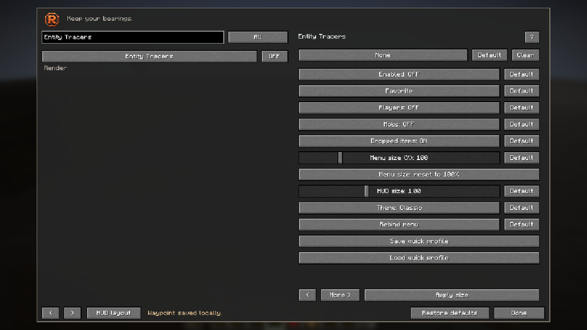
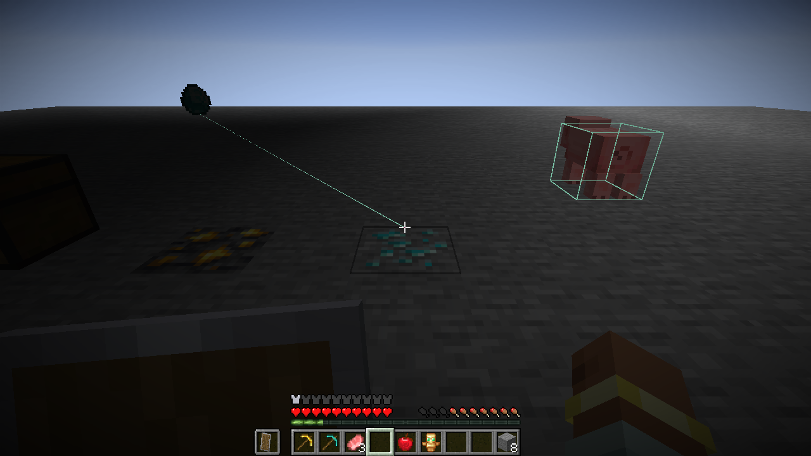

# Original Java-edition captures

**New: [browse the 39-scene Java screenshot tour](tour/README.md).** It covers texture minimum/default/60%/maximum, ore and custom-block filters, Finder, outlines, navigation, minimap, equipment, trajectory/build previews, Freecam, Fullbright restoration, Enabled/Favorites/search, keybind clearing, contextual help, profiles, themes and menu/HUD sizing. [Exact original PNG identities](tour/manifest.json).

The four acceptance captures below remain unchanged. The expanded tour is a separate visual showcase of the same released Java product, not 39 new functional acceptance tests.

These are direct Minecraft framebuffer screenshots from owned, disposable 26.3 test worlds. They are not mockups and have not been retouched. The menu is shared between Fabric and NeoForge; gallery filenames identify the captured loader. Native Horizon screenshots are in the parent gallery and are labelled separately.

- `rusty-neoforge-menu.png`: NeoForge 1.3.0-beta.1, fresh 45-check follow-up with the standalone R badge, 1280×720. Captured by Minecraft’s own Screenshot API through the separate QA fixture.
- `rusty-fabric-menu.png`: matching fresh Fabric 45-check run and direct framebuffer capture, with the same standalone badge.

- `rusty-java-hud-editor.png`: final shared 18-panel editor captured on NeoForge11, with complete readout widths and footer clearance.
- `rusty-fabric-textured-view.png`: physical X-key activation at default 25% original texture coverage, real received exposed and buried ores in a disposable fixture.

These are original 1280×720 framebuffer captures; the textured view is from Fabric13 and the final editor is from NeoForge11, without retouching. Only Status HUD is enabled by default; the editor previews all panels.

## Independent entity targets — Java 1.3.0-beta.5

Original Fabric 26.3 captures from the disposable game acceptance world, visually reviewed before publication. The new target filters and Default buttons were exercised on both loaders.

The Entity Tracers pane has separate Players, Mobs and Dropped items switches.

The line points to the dropped diamond on the left. The pig on the right has an ESP box and no tracer. This frame demonstrates different target selections together.
