# Keep your bearings.

**44 tools. One familiar interface.**

Textured world views, local navigation, movable HUDs and optional player assistance—built around Minecraft's own buttons, sliders and controls. Turn on what you need, keep the world in view, and make the layout your own.

**Fabric & NeoForge · Minecraft 26.3 · Java 25 · 1.3.0-beta.7**

[Installation guide](https://github.com/Justeck/Rusty/blob/main/java/README.md) · [Source code](https://github.com/Justeck/Rusty) · [Report an issue](https://github.com/Justeck/Rusty/issues) · [Validation report](https://github.com/Justeck/Rusty/blob/main/docs/JAVA_VALIDATION.md)

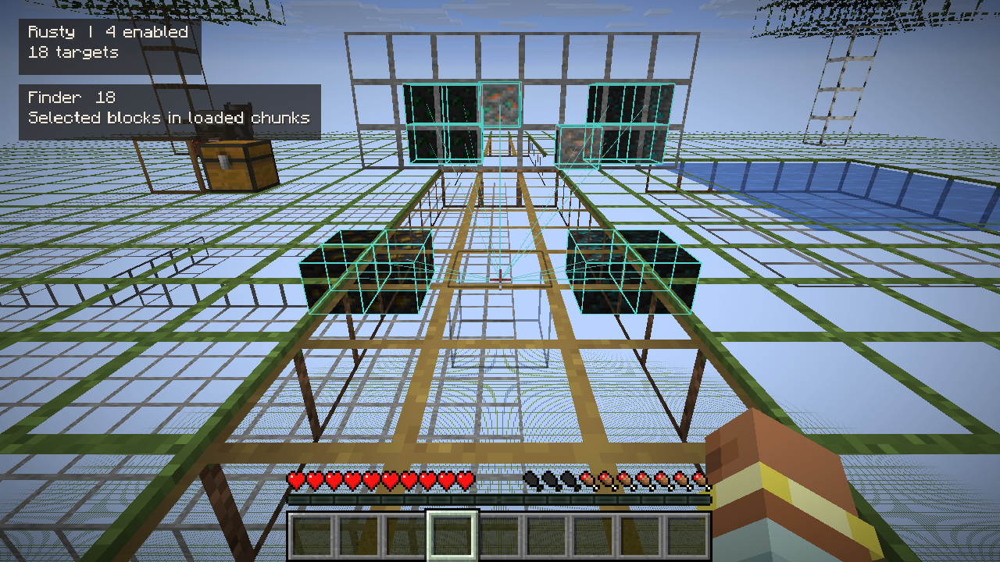

*Actual Fabric 26.3 test-world capture. The default 25% texture coverage keeps selected ores clear while showing the materials around you.*

[Browse the gallery images →](https://modrinth.com/mod/rusty-toolkit/gallery) · [Full 39-scene Java tour and menu controls →](https://github.com/Justeck/Rusty/blob/main/docs/screenshots/java/tour/README.md)

## See the blocks. Read the terrain.

X-ray keeps selected blocks whole and retains frames of the surrounding blocks' **original textures and tint**. The texture slider runs from thin textured edges to **100% ordinary terrain**, so you can choose how much context to keep.

Typical ores are preselected. Add any registered block ID to your selection. Finder adds target boxes and pointers, with radius, height and target limits to bound the work. Both use only loaded information the client has received. **X-ray changes terrain only. Enable Finder separately for target lines and boxes; X-ray toggles preserve Finder and your saved line preferences.**

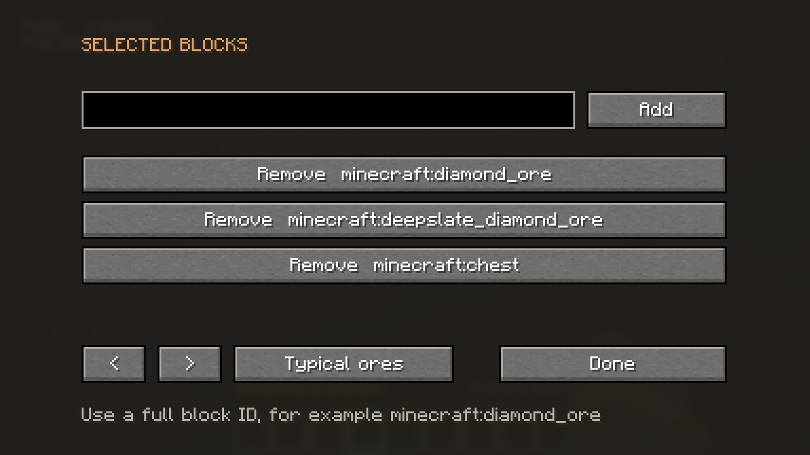

*Select ordinary registered block IDs, including custom storage targets. The Typical ores preset restores the ore selection.*

## Choose the lines you need

**Entity Tracers** has its own **Players**, **Mobs** and **Dropped items** switches. Select any combination or none, independently of **Entity ESP** boxes and **Finder** block pointers. Each choice has a Default button and is saved in profiles. Entity tracers have their own 128-line budget, so ESP boxes and Finder geometry cannot crowd them out. Older Java profiles inherit their former shared choices once; fresh settings select players and leave the feature off.

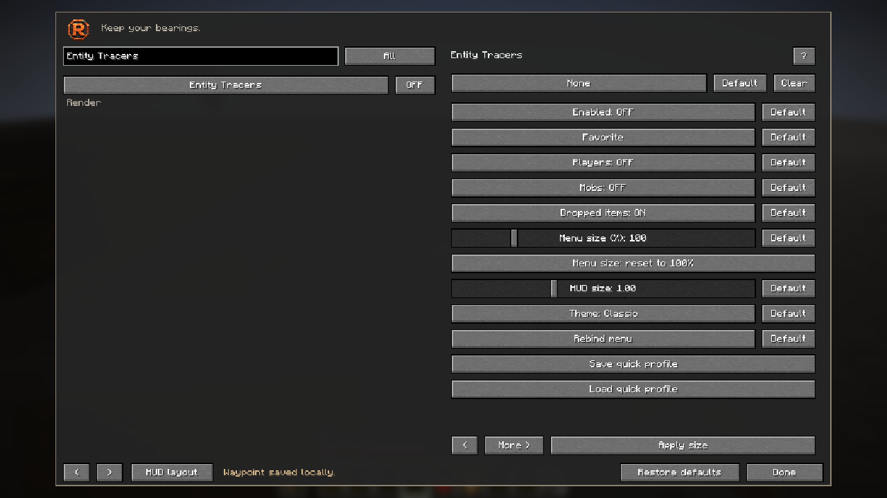

*Actual Fabric menu: independent Players, Mobs and Dropped items controls, each with a Default button.*

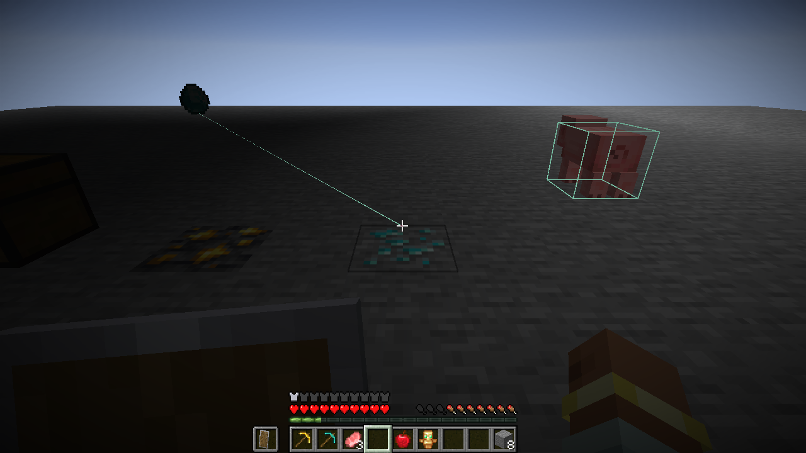

*Actual owned test-world frame: the line targets the dropped diamond on the left; the box highlights the pig on the right. Different target selections, both active together.*

## Make the interface yours

Open the menu with **Right Shift** or **Options → Rusty**. Search the catalog, browse **Enabled**, **Favorites**, **Recent** or categories, and click **?** for a short explanation. Rebind a shortcut, clear it completely, or choose Hold mode for X-ray.

**The former 70% menu size is now the 100% default.** Scale from **50% to 300%**, or reset to **100%**. Saved physical sizes are preserved. Menu size is independent of the HUD. Click **Edit HUD** for the clear game view, then drag an enabled overlay to move it or drag a corner handle to resize it proportionally. **Enter / Done** saves the draft and returns to the same menu; **Escape / Cancel** discards it. Opening the editor never enables a feature. Profiles preserve your local settings, shortcuts, favorites and arrangements.

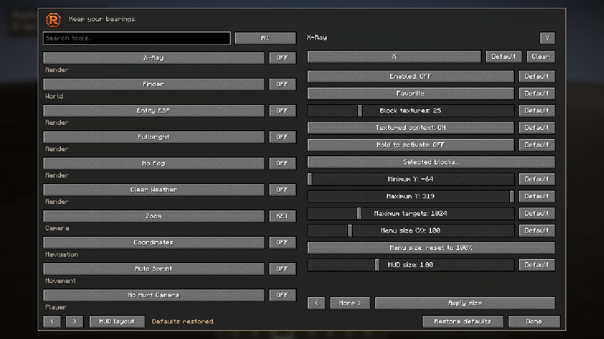

*Original Fabric 26.3 capture of the compact 100% menu, with per-setting Default buttons, shortcut Default/Clear and Restore defaults.*

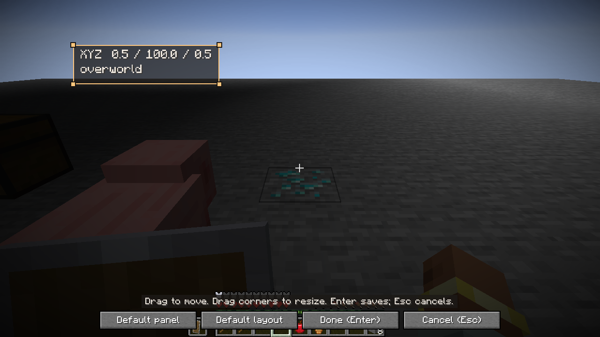

*Original Fabric beta.6 game capture: the coordinates overlay has been dragged and resized, with four corner handles visible. The world stays clear while editing. Only Status HUD starts enabled by default.*

**Default** buttons restore individual values and shortcuts. **Restore defaults** in the footer opens a confirmation and resets all Rusty preferences, shortcuts, menu size and HUD layout. Active tools stop. Saved waypoint and profile files are kept. Edit HUD also offers **Default panel** and **Default layout**.

**Enabled Mods** adds an optional alphabetical list of active Rusty tools, one per row in the top-left. It excludes its own name, updates as tools activate or stop, and can be moved/resized independently. Other tools do not turn it on automatically.

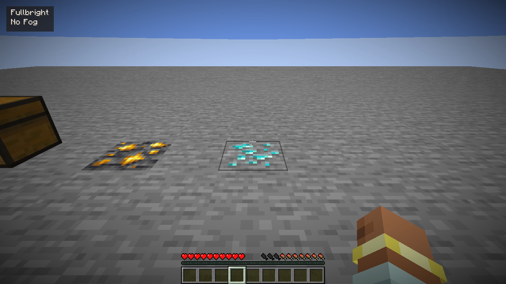

*Original, unretouched Fabric 26.3 gameplay capture from the owned acceptance world. Only Fullbright and No Fog are active; Status HUD is off.*

## Choose your toolkit

| Area | Included tools |
|---|---|
| **View & camera** | Textured X-ray, Finder, entity/storage outlines and tracers, Fullbright, No Fog, Clear Weather, Zoom, No Hurt Camera, detached Freecam |
| **Navigation** | Coordinates, compass, local waypoints, death markers, breadcrumbs, portal coordinates and a received-surface minimap |
| **World awareness** | Target information, chunk borders, sampled floor-light warnings and approximate projectile paths |
| **Information** | Enabled Mods list, equipment durability, biome/light, held-container contents, clock, speed, FPS and click counters |
| **Optional assistance** | Auto Mine resource routes, sprint/crouch/jump requests, tool/food/armor/refill/totem assistance, owned-hook bite reeling, explicit waypoint walking, one-action build planning and full-cooldown crosshair attacks |

**Start simple:** Status HUD is enabled by default. Other modules start off. Inventory and movement assistance use normal game actions; the server decides their results.

## A different perspective

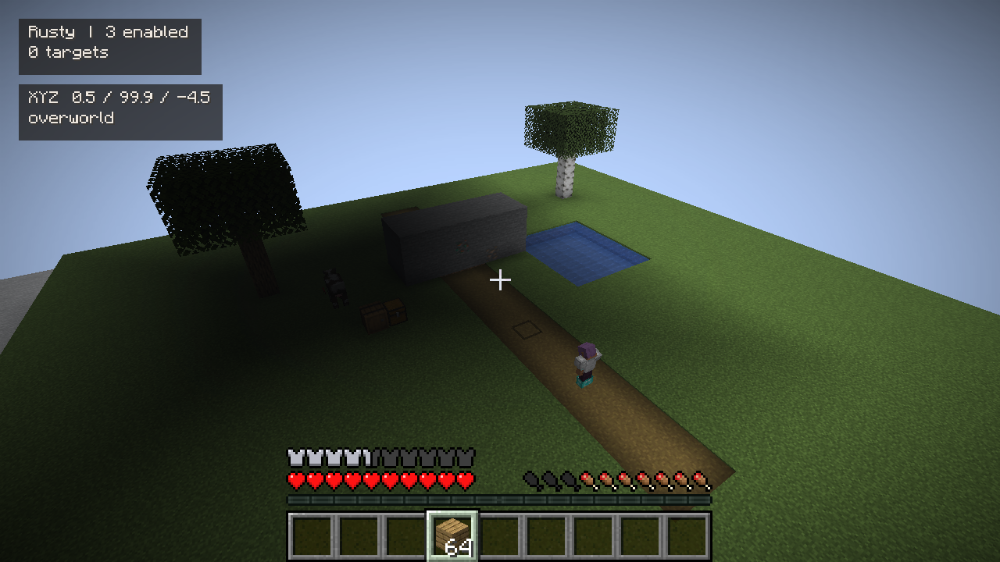

*Actual Freecam view. The camera is above the courtyard while the player body stays on the path. Your body remains in normal simulation.*

| Ordinary cave lighting | Fullbright enabled |
|---|---|
| 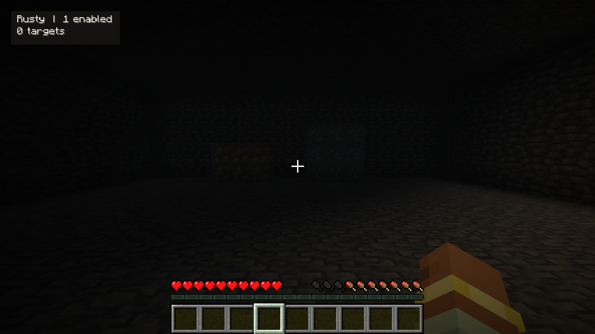 | 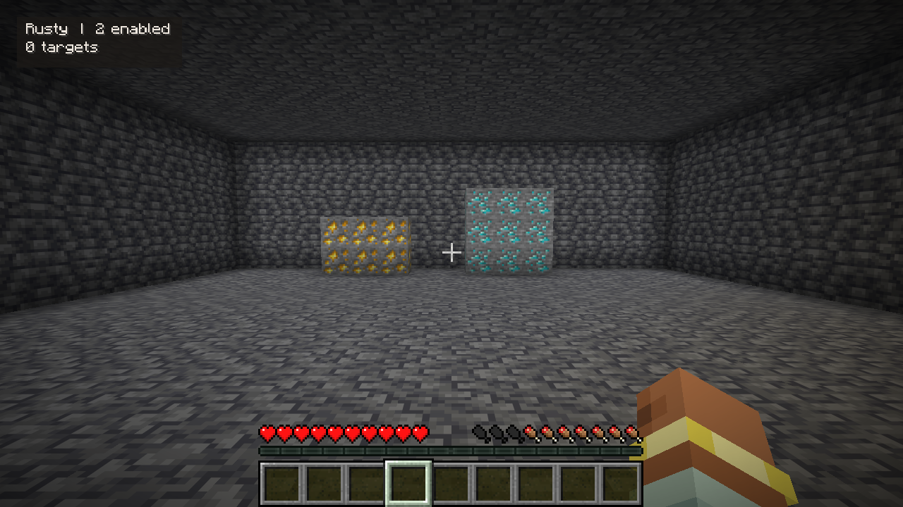 |

*Same test chamber and camera. The gallery also includes the restored-lighting capture after Fullbright is disabled. These are original game frames, not edited brightness comparisons.*

## Controls at a glance

| Action | Default |
|---|---|
| Open the menu | **Right Shift**, or **Options → Rusty** |
| Toggle X-ray | **X**; optional Hold mode |
| Hold Zoom | **C** |
| Change or remove a shortcut | The module's keybind control |
| Move a HUD panel | Drag its body in **Edit HUD** |
| Resize a HUD panel | Drag a corner handle in **Edit HUD** |

## Install the Java edition

1. Use **Minecraft 26.3** and **Java 25**. Choose one loader below.
2. Install the matching Rusty jar in that installation's `mods` folder. Fabric also requires Fabric API.
3. Launch the game and open **Options → Rusty**. Enable only the tools you want.

| Loader | Requirements | Rusty file |
|---|---|---|
| **Fabric** | Fabric Loader **0.20.1+**, Fabric API **0.165.2+26.3** | `rusty-fabric-1.3.0-beta.7.jar` |
| **NeoForge** | NeoForge **26.3.0.101** | `rusty-neoforge-1.3.0-beta.7.jar` |

Install **one Rusty loader jar**, not both. Use the **Versions** tab for downloads. Earlier game versions and snapshots are not supported by this beta.

**Playing through Horizon?** Use the separate [Horizon-native Rusty 1.3.0 release](https://github.com/Justeck/Rusty/releases/tag/v1.3.0), targeting **Horizon Nightly 66f3981 · native API 411 · Minecraft 26.3**. Native 1.3.0 adds Auto Mine to the Rust toolkit. [Native installation and exact validation scope](https://github.com/Justeck/Rusty/blob/main/docs/VALIDATION.md). These Java jars do not go into Horizon's native mod installer.

## Multiplayer: permission is explicit

Ordinary information and presentation tools work on unmodified servers. **Restricted tools need the server's explicit opt-in:** X-ray/Finder, through-block entity/storage views, Freecam and automatic combat/movement/inventory assistance. Without a grant, they remain inactive. Singleplayer grants capabilities locally; a profile cannot grant multiplayer permission.

Server owners can optionally install the matching Rusty server jar and configure `config/rusty-server-permissions.json`. Grants start empty, can be assigned per authenticated UUID or server-wide, and can be changed or revoked live. [Server setup and exact capability groups →](https://github.com/Justeck/Rusty/blob/main/java/README.md#multiplayer-permissions)

Rusty does not defeat server anti-X-ray, recover deliberately withheld blocks, bypass reach/cooldowns or override server authority. Freecam leaves your body in normal simulation and does not load chunks around the detached camera. Follow your server's rules.

## Tested, with clear limits

This beta passed fresh builds, **1,231 shared behavioral assertions**, additional mining-planner regressions, and **106 actual disposable-world game checks per loader**. Those runs cover Auto Mine resource collection, safe access tunnels, fluid refusal, manual and binding stops, no automatic restart, damage cancellation and server-authoritative denied mining. They also retain visual HUD editing, independent tracer/ESP controls, defaults, active-list behavior, menu transforms, and X-Ray/Finder regressions. Earlier dedicated loopback-server permission tests remain documented separately; they were not rerun for this Java patch. The 44-module inventory is not a claim that every option has exhaustive game coverage. [Read the full validation report →](https://github.com/Justeck/Rusty/blob/main/docs/JAVA_VALIDATION.md)

## Auto Mine

Choose one of eleven ore presets or an aimed Custom block, a search radius and a block goal. The bounded planner weighs walking and mining time, optionally opens conservative access tunnels and shows a green route preview. Ordinary controls perform actions. Server acknowledgments must settle predicted openings before they count. Supported collection steps approach the drops; manual input, menus, damage and unsafe or failed actions stop the mode. Off and unbound by default, with no automatic resume.

Multiplayer Auto Mine retains the existing **view + movement + assistance** server grants. It cannot discover ore hidden by server-side anti-X-Ray. [Full controls and limitations](https://github.com/Justeck/Rusty/blob/main/docs/AUTO_MINE.md).

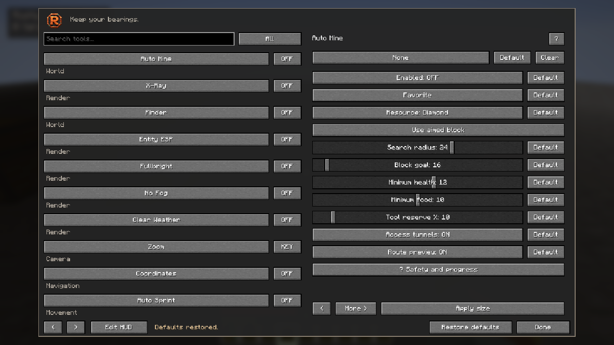

- **Rendering:** shaders, rendering replacements and arbitrary modpacks are unverified. Textured frames add geometry and can reduce FPS; terrain rebuilds are asynchronous.
- **World information:** the minimap shows received surface colors. Projectile paths do not predict entities, random spread or future movement. Light Risk samples floor light rather than proving spawn safety.
- **Assistance:** Auto Fish reels after a received bite and needs a manual cast. Identical rejected inventory sources require an explicit off/on rearm.
- **Compatibility:** this beta targets the exact game and loader versions above. No superiority over other clients or blanket public-server compatibility is claimed.

## Development & licensing

**AI disclosure:** code was predominantly produced with an AI coding assistant and iteratively tested. The in-game copper branding is AI-generated; page text is AI-assisted. No generative-AI service runs in-game. The project is submitted for Modrinth's manual review, including its restrictions on primarily AI-produced projects. Gameplay screenshots are original, unretouched game captures; copper branding is AI-generated and disclosed.

**Apache-2.0**, with applicable notices and attribution. No Minecraft game files or third-party mod binaries are bundled. [License](https://github.com/Justeck/Rusty/blob/main/LICENSE) · [Third-party notices](https://github.com/Justeck/Rusty/blob/main/THIRD-PARTY.md)
