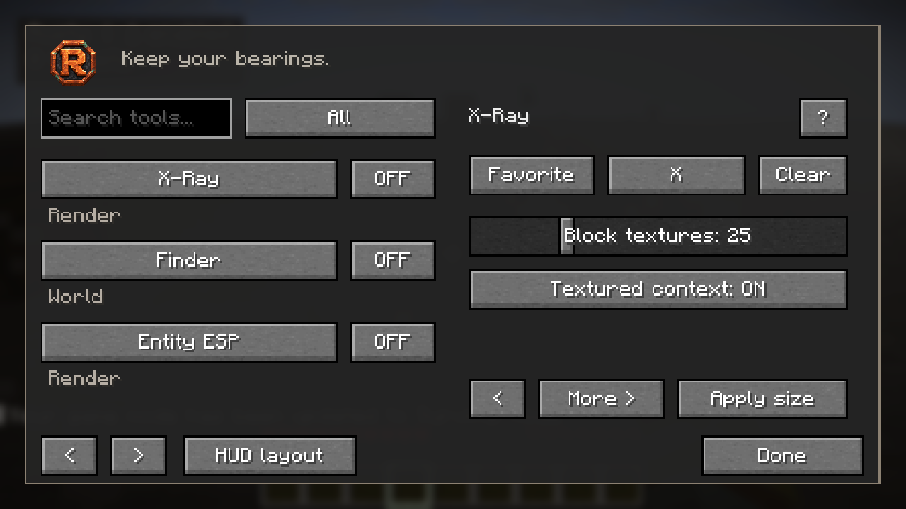
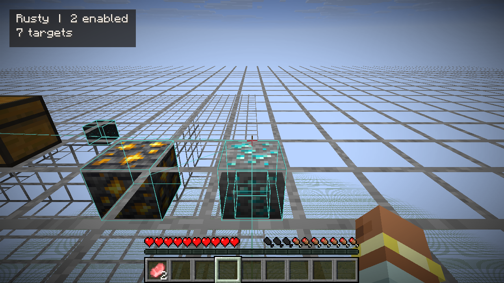

# Rusty for Fabric and NeoForge

Keep your bearings: textured world views, navigation, movable HUDs and ordinary player assistance in a familiar Minecraft interface.

**Java edition 1.3.0-beta.5 · Minecraft 26.3 · Java 25.** These jars run in Java Edition through Fabric or NeoForge. Horizon uses the separate native Rust package; never put a Java jar into Horizon's native mod installer.

The menu now defaults to **100% at the former 70% physical size**. Its **50–300%** slider and 100% reset scale only the menu; saved physical sizes and HUD placement remain intact. Drag the slider and release to apply, use keyboard arrows, or use **Apply size**.

## Install

[Download the Java beta](https://github.com/Justeck/Rusty/releases/tag/java-v1.3.0-beta.6).

Choose exactly one loader:

| Edition | Required environment | Download |
|---|---|---|
| Fabric | Minecraft 26.3, Fabric Loader 0.20.1+, Fabric API 0.165.2+26.3 | `rusty-fabric-1.3.0-beta.6.jar` |
| NeoForge | Minecraft 26.3, NeoForge 26.3.0.101 | `rusty-neoforge-1.3.0-beta.6.jar` |

Install the matching jar in that Java installation's `mods` folder. Fabric also needs Fabric API. Do not install both Rusty loader jars together. Java 25 is required. Earlier game versions, snapshots, shader replacements and third-party rendering mods are not validated.

Press **Right Shift** for the menu or use **Options → Rusty**. **X** toggles X-ray; **C** holds Zoom. Every shortcut can be rebound or cleared. X-ray also offers Hold mode. Status HUD is the only enabled module by default; restricted tools additionally need server permission in multiplayer.

## A view you can navigate

**Entity Tracers** has its own **Players**, **Mobs** and **Dropped items** switches, separate from Entity ESP. Use any combination or none; Default restores each choice. Older profiles inherit their former shared choices once. Fresh settings select players only and leave the feature off.

X-Ray changes terrain only. Enable Finder separately for target lines and boxes; their controls are under Finder. X-ray toggles do not enable Finder, change its state or reset saved line preferences.



X-ray retains the surrounding blocks' original material, tint and texture coordinates along their edges. **Block textures** controls retained face area: 25% initially, thin original-texture edges at minimum, full ordinary terrain at maximum. Selected blocks remain whole. Choose typical ores or add any registered block ID under **Selected blocks**. Finder scans only already received, loaded chunks; radius, height and target limits bound work. Terrain selection applies across the loaded view; Finder radius bounds scanning and pointers rather than forcing full-world remeshing as you walk.



The menu uses Minecraft buttons, text fields and sliders. Search tools; browse Enabled, Favorites, Recent and categories. Click **?** for a short explanation. Adjust menu size independently of HUD size. **Edit HUD** opens the clear game view with your enabled overlays. Drag a panel to move it, or drag a corner handle to resize it proportionally. Press **Enter / Done** to save and return to the same menu; **Escape / Cancel** discards the draft. **Default panel** and **Default layout** reset provisional arrangements. Default full-width packing keeps panels apart and reserves the hotbar area; manually placed panels can overlap by choice. Small viewports constrain the requested size so controls remain usable. Feature profiles preserve local bindings, theme, favorites and HUD arrangements.

## Tools

The 43-module catalog includes the independent Enabled Mods list, X-Ray/Finder, entity and storage outlines/tracers, Fullbright, No Fog, Clear Weather, Zoom, detached Freecam, compass/coordinates/waypoints/death markers/breadcrumbs, a surface minimap, equipment/environment/embedded-container information, chunk borders, sampled Light Risk, approximate projectile paths, portal coordinates, speed/clock/frame-rate/click counters, normal sprint/jump/crouch assistance, tool/food/armor/refill/totem assistance, full-cooldown crosshair attacks and explicit waypoint walking/build placement.

Important Java-edition differences:

- Minimap samples received surface colors; it has no underground layer. Frame Rate shows Minecraft FPS, without native Horizon low-percentile measurements.
- Projectile estimates support bows, pearls, snowballs and eggs against received blocks/fluid drag. They do not predict entity collisions, random spread or future movement. Light Risk is a floor-light sample, not a complete spawn prediction.
- Auto Fish reels one received bite on your owned hook; cast manually to begin or start the next cast. It does not invent bite information.
- Freecam moves only the view. Your body remains in ordinary simulation, can fall or take damage, and does not load chunks at the detached camera.
- Build Planner requests one normal held-block placement per explicit click. Vanilla multi-block items may have their normal multi-block effect. No automatic build loop or reach bypass exists.
- Inventory assistance uses normal client actions. To avoid blindly retrying an authoritative correction, identical attempted sources remain stopped until you explicitly toggle the corresponding feature off/on. Menus and manual input cancel automatic ownership. Servers still decide every result.

## Multiplayer permissions

Ordinary information and presentation tools work on an unmodified server. Restricted tools **fail closed** without the server's explicit opt-in; a local profile cannot grant permission. Singleplayer grants capabilities locally. This follows [Modrinth's project rules](https://modrinth.com/legal/rules).

A server owner can optionally install the matching Rusty jar (and Fabric API on Fabric). On first start it creates `config/rusty-server-permissions.json`, with no grants by default. Edit it to grant only the capabilities wanted, for example:

```json
{
  "schema": 1,
  "everyone": [],
  "players": {
    "PLAYER-UUID-HERE": ["view"]
  }
}
```

| Capability | Modules |
|---|---|
| `view` | X-Ray, Finder, Entity ESP/Tracers, Storage ESP, Freecam |
| `combat` | Trigger Bot |
| `movement` | Auto Sprint, Safe Walk, Auto Jump, Waypoint Walk |
| `assistance` | Auto Tool/Eat/Fish/Totem, Armor Assist, Refill, Build Planner |

`everyone` can grant capabilities to all players. Use actual authenticated player UUIDs on your server. Changes are checked once per second and sent only server-to-client. Revocation stops effective restricted features; requests/settings can remain saved. Disconnecting or changing connections clears grants; a new server must grant its own. A dimension change keeps that connection's permission while resetting world caches and camera ownership. Invalid files deny capabilities. Check your server's rules before using any tool.

Rusty never requests deliberately withheld ore information, defeats anti-X-ray, changes packet contents or alters server authority. Anti-X-ray replacement blocks cannot be recovered by a client view.

## Build

Use JDK25:

```sh
cd java
./gradlew :core:check :fabric:build :neoforge:build
```

On Windows use `gradlew.bat`. Loader jars and source jars appear under each loader's `build/libs`. The wrapper pins Gradle 9.8.2 and its distribution checksum. Official Loom 1.19.3 and ModDevGradle 2.0.148 supply game integration. Shared Java game code avoids a platform-specific JNI library; the Horizon runtime remains native Rust.

The separate `qa` source set is development-only and is never included in download jars. `-PrustyQa=singleplayer` requires an explicitly prepared disposable `run/saves/RustyLab` world and refuses other paths. Do not run game fixtures against personal saves. Remote fixtures refuse non-loopback addresses. See [Java validation](../docs/JAVA_VALIDATION.md) for actual evidence and limits; compilation is not game verification.

## License

Apache-2.0 with applicable project notices. Preserve [LICENSE](../LICENSE), [NOTICE](../NOTICE) and [third-party notices](../THIRD-PARTY.md). No Minecraft game files, account data, worlds, test fixtures or loader libraries are bundled. Rusty's original copper mark is distinct from the official Rust-language logo.

## Settings defaults and active list

**Enabled Mods** is an opt-in Interface tool: active Rusty tools appear alphabetically in separate top-left rows. Move or resize the panel in **Edit HUD**. A selected panel has **Default panel**, and **Default layout** restores all panel arrangements.

Visible **Default** buttons restore individual values and bindings; **Clear** removes a binding. **Restore defaults** in the menu footer opens Minecraft’s confirmation screen and restores all preferences and default shortcuts, stops active tools, and keeps saved waypoint/profile files. **Default ores** restores the normal block selection.
