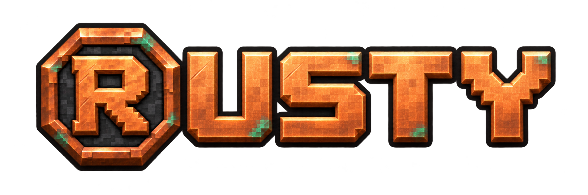

# Rusty Java 1.3.0-beta.2

**X-ray now changes terrain only.** Enable Finder separately for target lines and boxes. X-ray toggles do not activate Finder or overwrite line preferences; an independently enabled Finder still works with X-ray off. Terrain controls stay with X-Ray, and line/box controls move to Finder.

Fabric and NeoForge for **Minecraft 26.3 / Java 25**. Install one matching loader jar. Fabric needs Loader 0.20.1+ and Fabric API 0.165.2+26.3; NeoForge targets 26.3.0.101. The native Horizon package is a separate Rust edition.

This patch adds actual rendered regression checks for X-ray-only geometry, Finder opt-in and independent toggle directions. Fresh results and earlier test boundaries are kept separate in [Java validation](https://github.com/Justeck/Rusty/blob/main/docs/JAVA_VALIDATION.md).

Restricted multiplayer tools still require explicit server opt-in. No server anti-X-ray bypass or override of server authority. [Guide and permissions](https://github.com/Justeck/Rusty/blob/main/java/README.md). Apache-2.0 with project notices preserved.
